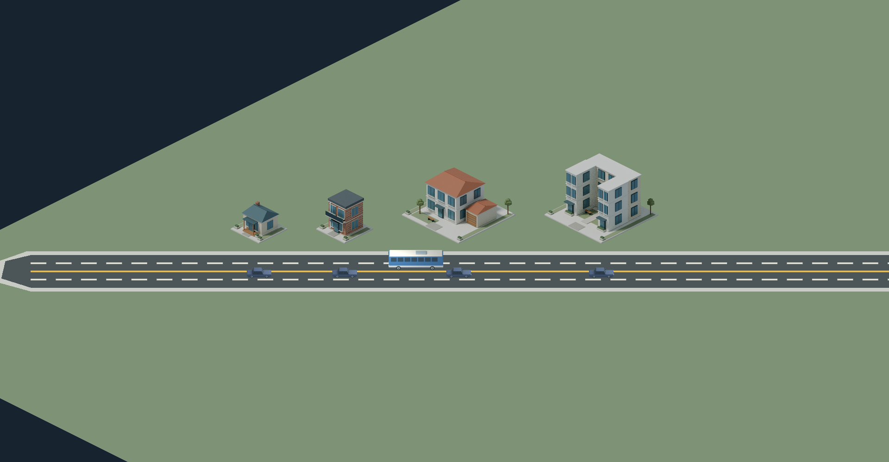

# 자동차를 기준으로 본 건물 비율 검토

2026-11-02. **현재 주거 건물과 자동차의 표시 축척은 일치한다. 일괄 확대·축소를 권하지 않는다.**
가장 작은 2×2 주택 두 종류는 실제로도 작은 집이다. 일반 가족용 단독주택으로 보이게
하려면 이 두 모델의 본체 설계를 검토하는 편이 적절하다. 이번에는 모델·게임 축척을 변경하지 않았다.

## 실제 게임 비교 화면

생성형 그림이 아닌 Godot `main.tscn`의 기존 건물·도로·차량 렌더링을 사용했다.
세 화면 모두 1920×1000, 줌 2.2로 동일하다. 화면 중심만 옮겼다.
각 건물 앞의 동일한 세단은 길이 4.85m, 너비 1.87m, 높이 1.48m다.
반대편 버스는 길이 10.8m, 너비 2.5m, 높이 3.15m다.
차량은 검토 장면에서 정지시켰고 제품 HUD는 숨겼다. 실제 도시의 배치나 교통 상태를 저장하지 않았다.

| 화면 | 왼쪽부터 |
| --- | --- |
| [소형 주택 비교](scale-validation/small.png) | 단층 전원주택, 2층 타운하우스, 정원형 단독주택, 안뜰형 연립주택 |
| [맨션·중층 비교](scale-validation/medium.png) | 벽돌형 맨션, 모던형 맨션, 발코니 아파트, 코너 주거타워 |
| [고층 비교](scale-validation/large.png) | L자형 주거 아파트, 계단형 주거타워 |



## 원본에서 잰 치수와 판단

한 칸은 4m다. 2×2 부지는 8×8m, 4×4는 16×16m, 8×8은 32×32m다.
아래는 부지 전체가 아닌 건물 본체의 바깥 경계 폭×깊이와 높이다.
지붕·굴뚝·옥상 장식은 본체 높이에서 제외했다. 꺾이거나 계단진 건물의 경계 면적을 실내 면적으로 간주하면 안 된다.

| 건물 | 부지 | 층수 | 본체 폭×깊이 | 본체 높이 | 판단 |
| --- | --- | ---: | --- | --- | --- |
| 단층 전원주택 | 2×2 | 1 | 5.2×4.5m | 3.05m | 소형 별장·원룸급. 본체 바닥 약 23.4㎡여서 작게 느껴지는 것이 맞다. |
| 2층 타운하우스 | 2×2 | 2 | 4.8×4.9m | 6.10m | 폭이 세단 길이와 비슷한 협소주택. 두 층의 단순 외곽 면적 합 약 47㎡이며 벽·계단 면적은 차감 전이다. |
| 정원형 단독주택 | 4×4 | 2 | 8.4×7.8m | 6.10m | 비교적 자연스러운 소규모 가족 주택. 별도 차고가 있다. |
| 안뜰형 연립주택 | 4×4 | 3 | 11.9×9.2m | 9.15m | 작은 부지의 연립주택으로 무리 없는 비율. |
| 벽돌형 맨션 | 4×4 | 4 | 11.8×9.3m | 12.20m | 소규모 공동주택으로 적절. 지붕·굴뚝 포함 최고점은 약 14.25m. |
| 모던형 맨션 | 4×4 | 4 | 11.8×9.3m | 12.20m | 같은 층 높이와 본체 크기. 옥상 요소 포함 최고점 약 14.49m. |
| 발코니 아파트 | 4×4 | 8 | 10.8×9.2m | 24.40m | 좁은 도시형 공동주택. 넓은 아파트 동으로 의도했다면 평면 재검토 대상. |
| 코너 주거타워 | 4×4 | 10 | 10.0×9.8m | 30.50m | 가늘고 높은 소형 주거타워로 일관됨. |
| L자형 주거 아파트 | 8×8 | 14 | 24.5×19.2m | 42.70m | 자동차와 비교한 전체 비율이 자연스러움. |
| 계단형 주거타워 | 8×8 | 18 | 26.4×20.5m | 54.90m | 최고점 약 56.5m. 층수에 맞는 높이. |

주거 모델의 층당 높이는 3.05m다. 확인된 8개 주거 모델의 출입문은 너비 1.2m,
높이 2.2m다. 맨션 두 모델은 같은 이름의 문 오브젝트가 없어 이 출입문 집계에서 제외했다.
정원형 주택의 차고 문은 2.65m×2.4m로 세단의 차체 폭·높이에 여유가 있다.
이는 정적인 치수 비교이며 문 개폐·실내 주행·실제 건축 법규 검증은 아니다.

## 주차 시설에서 추가로 확인할 점

주차타워와 공원·평면 주차장 원본 8종도 미터 단위로 측정했다.
4층 주차타워는 16×16m 부지, 주차층 간격 3.1m로 차량 대비 층 높이가 적절하다.
평면 주차장의 현재 생성 코드는 주차선 길이 5m, 간격 약 2.47m다.
4.85m 세단은 길이 여유가 총 0.15m뿐이고, 5.05m SUV는 선 길이보다 길다.
**큰 승용차까지 자연스럽게 수용하려면 주차면 길이를 재검토하는 것이 좋다.**
이번에는 주차면·통로·수용량을 바꾸지 않았다. 회전 반경과 실제 입출차는 별도 검증이 필요하다.
공원 크기는 부지 치수만 확인했으며 개별 놀이기구의 인체공학을 검증한 것은 아니다.

## 확인 방법과 한계

- Blender 원본 주거 10종·차량 20종·시설 8종을 열어 변형 적용 후 메시 경계를 측정했다.
  원본을 저장하거나 다시 생성하지 않았다. 측정치는 [원본 결과](scale-validation/source-measurements.json)에 있다.
- 건물 카메라의 1m 투영과 `building_catalog.gd`의 배율, 차량 카메라의 1m 투영과
  `traffic_controller.gd`의 배율을 비교했다. 줌 1에서 월드 X축 1m는 화면 (3.5, 1.75)px,
  수직 1m는 약 4.2866px다. 두 체계의 계산 오차는 최대 약 **0.00014%**다.
  이 값은 표시 축척의 일치도이며 실물 치수의 정확도를 뜻하지 않는다.
- 차량 PNG 160장의 알파 경계를 원본 메시 투영 경계와 비교했다. 최대 경계 차이는
  약 **1.96 원본 이미지 픽셀**로, 래스터화 가장자리 차이 수준이다. 재질·모든 내부 디테일 검증은 아니다.
- 차체 설계 치수는 사이드미러·등화·택시 표지 등 부속물을 제외한다. 전체 메시 치수는 더 클 수 있다.
  차량은 게임용 가상 모델이며 실제 브랜드 제원을 검증한 것이 아니다.
- 공원·주차장의 시설 GLB는 별도 전시 경로다. 위 2D 화면 축척 비교의 대상은 주거 10종과 차량 20종이다.
  발전·급수·하수 시설의 현재 절차형 임시 블록은 최종 건축 모델로 평가하지 않았다.
- 제품 소스·경제 수치는 변경하지 않았으므로 전체 게임 회귀 검사는 재실행하지 않았다.
  이번 실행 결과는 [분석 JSON](scale-validation/analysis.json),
  [건물 치수 CSV](scale-validation/building-dimensions.csv), 캡처 로그에 보존했다.

재현(저장소 루트, Blender·Godot·Python Pillow 필요):

```sh
blender --background --threads 2 --python tools/audit_asset_scale_blender.py -- --root "$PWD" --output "$PWD/docs/scale-validation/source-measurements.json"
python tools/analyze_asset_scale.py
DISPLAY=:99 XDG_DATA_HOME=/tmp/cities-do-data XDG_CONFIG_HOME=/tmp/cities-do-config XDG_CACHE_HOME=/tmp/cities-do-cache godot --audio-driver Dummy --path cities_do --resolution 1920x1000 --script ../tools/capture_asset_scale.gd -- "$PWD/docs/scale-validation"
```

캡처에는 실제 그래픽 디스플레이가 필요하다. `DISPLAY=:99`는 이번 환경의 Xvfb다.
새 환경에서는 사용 가능한 디스플레이를 지정한다. 전역 축척을 바꾸기 전에 이 비교를 먼저 확인한다.
