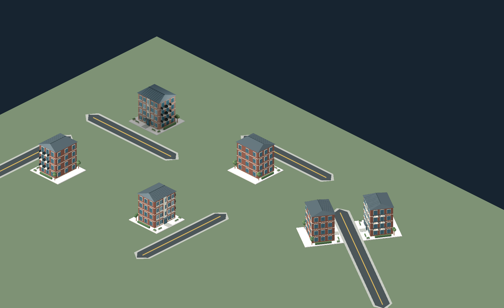

# 건물 정면은 출입 도로를 향한다

2026-11-02 사용자 확정 규칙. 화면의 남서쪽 같은 고정 방향으로 건물을 배치하지 않는다.
**건물의 주출입구·정면은 그 건물에 접근할 수 있는 일반도로 쪽을 향해야 한다.**
도로 양쪽, 반대로 그린 도로, 대각선·곡선의 각 로컬 구획에도 같은 규칙을 적용한다.
신규 건물 애셋에도 정면 축을 명시하고, 배치·성장·렌더링에서 같은 방향을 사용한다.

관련 조사: [도로와 부지 사이 간격](BUILDING_ROAD_GAPS_KO.md).
현재 정면 방향과 실제 도로 접촉은 별개이며, 접근 판정은 아직 10m 근접 허용이다.

## 현재 구현

- `core/building_frontage.gd`가 건물 상태의 `front_direction`(월드 X/Y 단위 벡터),
  `front_road_id`(안정적인 road.parcel_id)를 정한다. 고속도로는 출입 도로로 선택하지 않는다.
- 일반 건설은 도로 로컬 정사각 부지를 사용한다. 기본 정면은 해당 구획의
  `-frame.outward`다. 반대편 구획은 반대 방향을 향한다. 입력 폴리라인의 진행 방향이
  바뀌어도 자기 부지에서 도로를 향한다.
- 접근 가능한 기존 출입 도로를 우선 유지한다. 다음은 구획의 원래 도로,
  그다음은 가까운 일반도로다. 모퉁이에 도로를 추가했다고 기존 건물이 불필요하게 뒤집히지 않는다.
- 원래 도로가 사라지거나 성장 후 접근할 수 없으면 다른 접근 가능한 일반도로를 선택한다.
  부지는 이동·변형하지 않고 기존 정사각형의 네 면 중 도로 쪽 면을 정면으로 삼는다.
  도로가 모두 사라지면 연결 ID를 -1로 두고 마지막 방향과 건물을 유지한다.
- `add_building_at`, 기존 authored `add_building` / `place_catalog_building`, 두 성장 경로,
  도로 추가·철거에 연결했다. 도로 미리보기는 상태를 바꾸지 않는다.
- 기존 월드축 고정 시나리오는 부지의 네 면 중 도로를 향하는 면을 고른다.
  대각선 도로 때문에 건물의 정사각 부지를 임의로 돌려 주변 공간을 침범하지 않는다.
  실제 도로 로컬 구획은 그 도로 블록의 각도를 그대로 사용한다.

## 정면 표시와 원본 모델

기존 PNG는 한 방향으로만 촬영되어 있으므로 이미지를 회전하거나 찌그러뜨리지 않는다.
원본의 정면은 Blender -Y, 내보낸 Godot GLB의 +Z이며 월드 평면에서는 (0,+1)이다.
카탈로그 `front_axis: [0,1]`로 이 규약을 명시했다.

`tools/export_building_models.py`가 기존 주거 .blend 10개를 열어 메시·재질만 GLB로 내보낸다.
원본 .blend는 덮어쓰지 않고 새 건축 모델이나 가격 항목을 만들지 않는다.
GLB와 `height_m`/`model` 정보는 `assets/buildings/catalog.json`에 연결했다.
Blender 절차형 벽돌 셰이더는 glTF에서 그대로 재현되지 않으므로 내보낸 복사본에서는
원래 기본 벽돌 색을 유지한다. 반복 벽돌 무늬·Cycles 조명까지 동일한 결과는 아니다.
원본 셰이더와 기존 PNG는 그대로 보존했다.

`core/building_views.gd`는 실제 GLB를 필요한 방향으로 회전시켜 투명 SubViewport에서
한 번 렌더링하고 이미지로 공유한다. 최대 64개 외관/방향 조합을 캐시하며 동시에
하나씩 렌더링한다. 메인 장면의 카메라는 회전하지 않는다. 카메라 높이각 30도와 미터당
픽셀 배율을 기존 건물·차량에 맞춘다. 부지 중심 기준 앵커로 배치해 반대 방향도 같은 위치에 선다.
기존 PNG의 정면·부지 방향이 맞으면 그 PNG를 계속 사용한다.

`main.gd`의 그리기와 클릭 판정은 같은 `building_visual()`의 이미지·사각형을 사용한다.
방향 이미지 준비 중이거나 외관 애셋이 없는 프로토타입 건물은 입체 블록에 도로 쪽
출입문을 표시한다. 뒤쪽 문은 가려진다. headless에서는 그래픽 이미지를 만들지 않고
같은 방향 데이터와 입체 블록을 사용한다. 화면 표시가 건물 충돌·성장·경제 계산을 바꾸지 않는다.

## 이번 검증

- [방향 검사 로그](frontage-validation/test_building_frontage.log): **138/138**.
  일곱 도로 각도, 역순 입력, 양쪽 구획, 성장 후 방향 유지, 출입 도로 철거·전환,
  고속도로 제외, 10종 GLB 연결과 실제 미터 높이를 검사했다.
- [전체 결과](frontage-validation/results.json): **16개 테스트 스크립트 통과**.
  기존 UI 검사의 자식 순서 의존 접근은 `scene.controls_panel` 참조로 바꿨다.
  UI 버튼 기능·건물 선택·모든 기존 테스트도 통과했다.
- [실제 화면](frontage-validation/road-facing.png): 동일한 벽돌 맨션을 네 방향과
  대각선 도로 양쪽에 배치했다. 실제 GLB 방향 이미지의 알파 영역 클릭도 확인했다.
  캡처는 Godot 4.6.3 Compatibility / llvmpipe, 1800×1100이다.
- [캡처 로그](frontage-validation/capture.log), [GLB 내보내기 기록](frontage-validation/export.log).
  리소스 임포트의 최종 실행에는 스크립트 오류가 없다.



재현(저장소 루트):

```sh
blender --background --threads 2 --python tools/export_building_models.py -- "$PWD"
XDG_DATA_HOME=/tmp/cities-do-data XDG_CONFIG_HOME=/tmp/cities-do-config XDG_CACHE_HOME=/tmp/cities-do-cache godot --headless --editor --import --path cities_do --quit
XDG_DATA_HOME=/tmp/cities-do-data XDG_CONFIG_HOME=/tmp/cities-do-config XDG_CACHE_HOME=/tmp/cities-do-cache godot --headless --path cities_do --script tests/test_building_frontage.gd
DISPLAY=:99 XDG_DATA_HOME=/tmp/cities-do-data XDG_CONFIG_HOME=/tmp/cities-do-config XDG_CACHE_HOME=/tmp/cities-do-cache godot --audio-driver Dummy --path cities_do --resolution 1800x1100 --script ../tools/capture_building_frontage.gd -- "$PWD/docs/frontage-validation/road-facing.png"
```

`DISPLAY`는 실행 환경의 실제 디스플레이에 맞춘다. 캡처는 headless 검사와 별개다.
전체 테스트는 `cities_do/tests/test_*.gd`이며 종료 코드와 오류 로그를 함께 확인한다.

## 남은 범위

현재 건물 상태는 메모리 기반이며 별도의 저장 게임 직렬화 기능을 이번에 추가하지 않았다.
향후 저장 시 정면 벡터와 출입 도로 ID도 보존해야 한다. 보행자 출입 경로·차량 진입로·
주차 시뮬레이션은 이번 범위가 아니다. 공원·주차 시설의 별도 전시 장면과 절차형
발전/상하수도 임시 시설에 주거 카탈로그 렌더러를 적용했다고 주장하지 않는다.
이 시설들도 실제 도시 건설 모델에 연결할 때 출입 방향 규칙을 적용해야 한다.
곡선 구획은 기존의 짧은 직선 블록 근사를 유지한다. 대도시에서 방향 조합이 64개를
넘으면 재렌더링 비용이 늘 수 있으며 모바일·대규모 도시 성능은 아직 검증하지 않았다.
