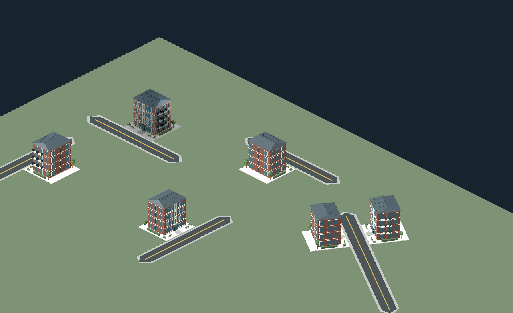

# 도로 바로 옆 격자와 최대 1.5m 간격

2026-11-02 사용자 확정: **건물 부지는 도로 바로 옆 격자에 위치하고, 도로 바깥 경계와
부지 정면 사이의 허용 간격은 최대 1.5m다.** 이전의 2.5셀=10m 근접 허용을 대체한다.
1칸=4m이므로 런타임의 한도는 **0.375셀**이다.

거리는 보도를 포함한 도로 경계부터 **부지 앞면**까지다. 건물 벽·출입문부터 검은
아스팔트까지의 거리를 뜻하지 않는다. 모델 안의 앞마당·계단·조경과 원본 축척은 유지했다.
새 격자나 기둥을 화면에 항상 표시하지 않는다.

## 적용

- `growth_config.gd`: `road_access_distance = 1.5 / 4.0`.
- `building_frontage.gd`: 일반도로와 부지 한 면의 양 끝·중간 지점이 모두 허용 거리
  안에 있어야 출입 도로 후보가 된다. 도로 끝 근처의 꼭짓점 하나만 가깝다고 인정하지 않는다.
- `city_model.gd`: 신축·수동 시나리오 배치·성장과 출입 방향 선택이 같은 후보 판정을 쓴다.
  도로 충돌·다른 건물·경계·교차로 검사는 그대로 적용한다.
- 도로 로컬 격자에서 자기 도로의 바로 옆 줄 v=0은 간격 0m다. v=1,2는 각각 4m,8m
  떨어지므로 더는 건설되지 않는다. 단, 다른 일반도로에 실제로 접근 가능한 면이 있다면
  그 도로를 출입 도로로 선택할 수 있다. 클릭한 깊이를 무조건 v=0으로 바꿔 겹쳐 놓지 않는다.
- 성장도 같은 제한을 지킨다. 원래 중심을 포함하는 유효한 축소 후보가 없다면 기존 부지를
  유지하고 실패한다. 접도 조건을 무시하고 뒤쪽으로 물러나 성장하지 않는다.
- 코너의 기존 유효한 도로·정면은 유지한다. 방향 벡터의 작은 부동소수점 오차 때문에
  성장할 때마다 이미지 방향 캐시가 달라지지 않도록 같은 정면 벡터를 재사용한다.

공유 배치 검사를 쓰는 현재 발전/상하수도 임시 시설에도 거리 조건이 적용된다.
가격·공급량·처리량·단가는 바꾸지 않았다. 기존 도시 건물을 일괄 이동·철거하는 기능은
추가하지 않았다. 저장 게임 시스템도 이번 범위가 아니다.

## 실제 비교 화면

동일한 맨션을 네 방향과 대각선 도로 양쪽에 놓았다. 이전과 같은 1800×1100,
줌 1.8, 카메라 위치에서 실제 `main.tscn`과 기존 PNG/GLB 방향 렌더러로 캡처했다.
이미지를 합성하거나 건물 스프라이트를 늘이지 않았다.

| 이전 | 현재 |
| --- | --- |
| [방향만 수정한 화면](frontage-validation/road-facing.png) | [도로 옆에 붙인 화면](adjacent-lot-validation/road-facing-adjacent.png) |
| 축 방향 네 건물의 부지 간격 4m | 네 방향·대각선 모두 약 0m |



미세한 음수 값(약 -0.000006m)은 부동소수점 오차이며 허용 기하 오차보다 작다.
맨션 본체 앞에는 기존 부지 안 여백 약 3.35m가 남는다. 이것을 부지 밖 빈 격자로 해석하지 않는다.

## 기존 예시 장면 갱신

- `core/residential_showcase.gd`의 주거 10종을 직선 4차로의 보도 경계와 부지 앞변이
  닿는 행으로 바꿨다. 기존 대각선 도로에 꼭짓점만 가까운 배치를 제거했다.
- `bottom_ui_preview.gd`의 34개 주거와 유틸리티 예시를 새 거리 조건에 맞춰 재배치했다.
- `power_demo.gd`, `water_demo.gd`와 캡처용 장면의 건물·시설도 보도 옆으로 이동하고
  해당 공급원에 붙는 전선·배관 시작점을 함께 옮겼다. 실제 수요·공급·요금 검사는 통과했다.
- 기존 검사에서 4m 이상 떨어져 있던 배치 예시를 새 규칙에 맞게 옮겼다. 검증 한도를
  완화하지 않았으며 클릭 검사도 바로 옆 격자를 선택하도록 고쳤다.

## 이번 검증

- [전체 결과](adjacent-lot-validation/results.json): **17개 테스트 스크립트 통과**.
- [새 간격 검사](adjacent-lot-validation/test_road_setback.log): **49/49**.
  0/1.49/1.50m 허용, 1.51/4/8m 거부, 수평·수직·대각선 양쪽의 격자 깊이,
  확장/축소의 접도 보존과 도로 끝의 꼭짓점 근접 거부를 확인했다.
- [정면 검사](adjacent-lot-validation/test_building_frontage.log): **138/138**.
  이전에 8m 떨어져 있던 코너 도로 예시도 이제 양쪽 보도가 부지에 닿도록 수정했다.
- [거리 재측정](adjacent-lot-validation/gaps.json): 깊이별 24사례, 비교 장면 4곳,
  주거 전시 10종. 뒤쪽 줄은 거부되며 비교/전시 부지 간격은 0m다.
- [실제 캡처 로그](adjacent-lot-validation/capture.log): 여섯 방향의 거리와 이미지 알파 영역
  클릭을 확인했다. 그래픽 캡처와 headless 검사는 별개다.

재현(저장소 루트):

```sh
XDG_DATA_HOME=/tmp/cities-do-data XDG_CONFIG_HOME=/tmp/cities-do-config XDG_CACHE_HOME=/tmp/cities-do-cache godot --headless --path cities_do --script tests/test_road_setback.gd
XDG_DATA_HOME=/tmp/cities-do-data XDG_CONFIG_HOME=/tmp/cities-do-config XDG_CACHE_HOME=/tmp/cities-do-cache godot --headless --path cities_do --script ../tools/audit_building_road_gaps.gd -- "$PWD/docs/adjacent-lot-validation/gaps.json"
DISPLAY=:99 XDG_DATA_HOME=/tmp/cities-do-data XDG_CONFIG_HOME=/tmp/cities-do-config XDG_CACHE_HOME=/tmp/cities-do-cache godot --audio-driver Dummy --path cities_do --resolution 1800x1100 --script ../tools/capture_building_frontage.gd -- "$PWD/docs/adjacent-lot-validation/road-facing-adjacent.png"
```

곡선 구획은 기존의 짧은 직선 블록 근사를 유지한다. 대규모 도시·모바일 성능은 미검증이다.
