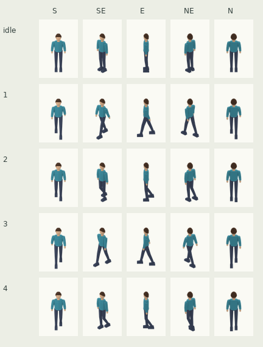
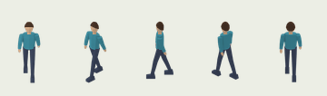
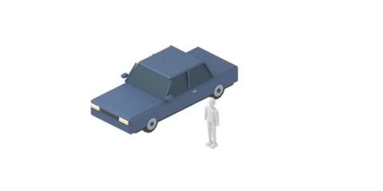

# 시민 부위 애셋 · 시험 성인1명

브랜치 `assets/citizen-adult-pilot-20261114`, 기준 main `71ee703`.
중성적인 기본 성인1명을 원래 Blender Python 기하로 제작했다. 나머지 머리카락/의상/아동 변형은 만들지 않았다.
게임 코드/인구/렌더러/카탈로그는 변경하지 않았다.

## 실제 PNG 크기 확인


각 사람 셀은 원본64×96px를 확대하지 않고 배치했다. 열은S/SE/E/NE/N, 행은idle/걷기1/2/3/4다.
피부/머리카락/상의/하의 각각 임의색을 곱했다. [4배 최근접 확대](preview-sheet-4x.png)는 관찰 보조이며 납품 스프라이트 크기가 아니다.


움직이는 줄 역시 원본 크기다. 4개 포즈에 각200ms, 전체.8초 루프이며 원점 이동이 없다.
[걷기4배 확대](walk-preview-4x.gif).

## 원본 규격과 삼각형

| 부위/항목 | 결과 |
|---|---:|
| body · 얼굴/목/손 | 172삼각형 |
| hair · 기본 짧은 머리 | 70삼각형 |
| top · 긴팔 상의 | 212삼각형 |
| bottom · 바지/신발 | 204삼각형 |
| 합계 | **658삼각형** |
| Idle 키 | **1.750m** |
| 뼈대 | CitizenRig 1개,14뼈 |
| 스프라이트 | 4부위×5방향×5포즈 = **100장** |
| 각 PNG | 64×96px, RGBA, 투명, 무채색 |
| 기준점 | 캔버스좌상단 기준(32,84)px |
| 축척/카메라 | 카메라 화면 평면40px/m, 정사영/앙각30° |

Blender 위+Z/정면−Y, 미터 단위다. 정지 상태 양발 바닥 경계의 중앙은(0,0,0), 발바닥z=0이다.
높이는 머리카락 최고점까지 포함한다. 걷기에는 자연스러운 골반 높이 변화가 있으므로 모든 포즈의 최고점이1.75m로 고정되지는 않는다.
30도 위에서 보는 월드Z 높이는 cos30으로 투영되므로1.75m 키는 화면에서 대략61px다. 모델을70px 높이로 억지 변형하지 않았다.
최종 게임 줌/스프라이트 표시 배율은 게임에서 확인 후 조정할 수 있다.

각 부위 메시는 하나의 밝은 무채색 재질만 쓴다. 눈/코/입/치아/손가락은 없으며 손은 단순한 덩어리다.
상의는 하의 허리를7cm 덮고, 목/머리·소매/손목도 겹친다. 머리카락은 기본 머리의 윗면/옆/뒤를 약간 감싼다.
네 메시는 같은 armature modifier와 골반/척추/머리·양 위팔/아래팔·허벅지/종아리/발 본을 공유하며,
모든 정점의 스킨 가중치 합은1이다. 뼈대 이름/휴지 좌표/부모 관계는 spec.json에 기록했다.

## 기존 방식과의 차이 · 가림 처리를 위한 깊이 데이터

기존의 미터/좌표계/30도 정투영/실제 지오메트리 렌더 규칙을 유지했다.
**부위별 PNG를 고정 순서로만 겹치면 옆모습의 앞쪽 손/다리와 뒤쪽 옷의 가림을 정확하게 표현할 수 없다.**
그래서 기존3D의 깊이 관계를 보존하는 합성 규약을 함께 만들었다.

- 납품 PNG100장은 **다른 부위에 가려지기 전의 독립 부위**다. 다른 옷/머리 조합을 위해 필요한 숨겨진 부분을 미리 잘라내지 않았다.
- `layer-depths.npz`는 같은100개 파일명/포즈에 대응하는96×64 uint16 깊이 배열이다. 단위는 카메라 Z pass의mm이며 작은 값이 앞,65535는 투명이다.
- 게임에서 회색RGB에 부위별 색을 곱한 뒤, 픽셀마다 네 부위를 깊이순으로 정렬해 뒤→앞 alpha-over로 합성한다.
  straight-alpha PNG이므로 premultiplied 표현으로 바꿔 합성 후 필요하면 되돌린다. 참고 구현은 tools/compose_citizen_pilot.py에 있다.
- 깊이도 각 부위와 함께 보관되므로 새 의상 하나에25PNG+해당 깊이만 추가하면 된다. 모든 완성 조합을 다시 렌더하는 방식이 아니다.
- SW/W/NW는 SE/E/NE의 **RGBA와 깊이를 같이** 수평 반전한다. 캔버스 경계 좌표 중심x=32를 기준으로 하므로 발 기준점은 유지된다.
- 이 깊이 합성은 현재 게임 렌더러에 연결하지 않았다. **현재 PNG를 단순 Sprite2D4개 고정 순서로만 그리면 위 확인 시트와 가림이 달라질 수 있다.**
  게임 화면 검토 시 이 합성 규약을 연결하거나 동등한 깊이 처리가 필요하다.

## 동작/파일 계약

- 시민 원본은 [citizen.blend](../../assets/citizens/adult-pilot-01/citizen.blend). 기본 열기 상태는Idle이다.
- 행동은Idle1개와Walk1개다. Walk의4위상은 원본 프레임1/5/9/13에서 렌더하고 파일 이름은1/2/3/4다.
- 원본17프레임은1과 동일한 루프 접점이며, 재생 범위는1~16으로 끝 포즈를 중복 재생하지 않는다. Cycles fcurve modifier가 반복한다.
- 발 접지는 양발 중 낮은 쪽을0에 맞춘다. 네 납품 걷기 포즈에서 발이 땅 아래로 내려가지 않고 적어도 한 발이0에 닿는다.
- [sprites/](../../assets/citizens/adult-pilot-01/sprites/)는 `<body|hair|top|bottom>_<S|SE|E|NE|N>_<idle|1|2|3|4>.png`100개다.
- [spec.json](../../assets/citizens/adult-pilot-01/spec.json), [깊이 sidecar](../../assets/citizens/adult-pilot-01/layer-depths.npz), 확인 시트와GIF는 같은 폴더다.
- 향후 성인 부위는 같은 뼈대 휴지 좌표/본 이름/가중치 접합/시점/포즈/카메라/캔버스/기준점을 사용해야 한다.
  아동은 비율이 달라 별도 archetype의 뼈 길이/부위를 설계해야 하며 성인 부위를 그대로 호환한다고 보장하지 않는다.

## 같은 미터 축척 비교


기존 명목 길이4.85m 세단과 성인1.75m를40px/m·30도로 같은 장면에 놓았다. 위치만 바꾸고 메시 크기는 바꾸지 않았다.
이것은 실제 Blender 원본 비교이며 Godot 게임 HUD/배치 화면 캡처가 아니다.

## 이번 실행한 검증

- [뼈대·카메라29검사](rig-validation.json):4메시/1뼈대/14본/스키닝/재질/미터/키/원점/접합,
 4포즈 접지·원점 고정·루프17=1의 정점 차이0·반복 끝 스텝·100개 동일 기준점/40px/m 등을 통과했다.
- [스프라이트·합성10검사](composite-validation.json): 정확한 파일명100개와 깊이 대응,25합성,4프레임GIF,
  허리/목/양 손목100개 실제 투영점의 알파가 모두251/255 이상으로 투명 틈이 없음을 확인했다.
- [PNG100장 검사](sprite-validation.json):64×96/RGBA/무채색/투명/프레임 안/깊이 대응/해시.
- 생성은 Blender4.3.2의 원래 기하/직접 만든 뼈대/Action만 사용했다. 외부 모델/텍스처/생성형 이미지/API/에이전트 없음.
- 참고한 기존 규약은 docs/ASSET_SCALE_REVIEW_KO.md와 vehicle/reference/rig-contract의 미터/축,
  capture_original_vehicle_sprites.gd의30도/45도 방향이다. 차량 뼈대/외부 사람 생성기를 실행한 것은 아니다.
- 시민 지오메트리·스키닝·회색 재질은 새 원래 코드다. 새 외부 스킬/라이선스/패키지는 도입하지 않았다.
  비교용 기존 세단은 프로젝트 차량 원본을 읽기만 했으며 기존 zstack MIT/고정판 출처는 기존 차량 기록 그대로다.
- 렌더는4배256×384/24샘플 CPU Cycles 후 premultiplied 상태에서 축소해64×96 straight RGBA로 저장했다.
  깊이는 원래 Z pass를mm로 양자화했고, 축소로 생긴 가는 알파 가장자리에는 가까운 유효 깊이를 전파했다.
- 확인 시트는 기존 Pillow/Numpy로 실제 회색PNG에 색을 곱해 합성했다. 문자 표시만 기존 시스템 DejaVu 폰트를 썼다.
- 현재 납품한25조합의 가독성/접합을 확인했으며, 미래의 모든 옷 조합/아동·장신구/중간 보간 프레임 전체 접지,
  게임 렌더/깊이 셰이더/실제 줌/가려짐 정렬/이동 경로/수천 명FPS·메모리 성능은 이번에 검증하지 않았다.

## 재현/축척 조정

```sh
blender -b --factory-startup -t 4 -P tools/build_citizen_adult_pilot.py
blender -b --factory-startup -t 4 -P tools/render_citizen_adult_pilot.py
python tools/compose_citizen_pilot.py
blender -b --factory-startup -t 2 -P tools/audit_citizen_projection.py
blender -b --factory-startup -t 2 -P tools/verify_citizen_adult_pilot.py
python tools/verify_citizen_sprites.py
blender -b --factory-startup -t 4 -P tools/render_citizen_scale_review.py
```

tools/citizen_pilot_common.py의 **PIXELS_PER_METRE=40**가 축척 파라미터다. 카메라를 조정할 때도 발 기준점은 자동 보정한다.
같은 파일의WIDTH/HEIGHT/ANCHOR가 이번 기본 캔버스 계약이다. 이번 합성기는64×96를 기준으로 하므로 캔버스 자체를 바꾸면
합성/검사 레이아웃도 함께 맞춰야 한다. 이번 조정 대상은 캐릭터 메시 키가 아니라 카메라의px/m이다.
렌더 중간 PNG/EXR/NPY는/tmp에만 남기고 납품 폴더에는 부위PNG100장과 깊이 sidecar만 넣었다.

## 비용·수요·용량 제안 · 외관이므로 추가 경제 효과 없음

이 시민 외형1개에 시정부 구매비0doth·추가 유지비0doth/(외형·게임월)를 제안한다. 기존 주민 표시를 위한 재사용 리소스이며
신규 주민/가구/일자리/시설 수용량을 생성하지 않는다. 50,000doth 시작 자금 영향은0이다.
기존 주민 생활수요는 인구 모델이 계산하므로 이 스프라이트를 그릴 때 용수/전력/식량/하수/쓰레기를 다시 더하지 않는다.
외형의 별도 운영 전력/용수/연료/폐기물 수요는0이며 렌더 비용은 게임 밸런스 재화가 아니다.
정격 표시는 시민1명/외형 인스턴스, 부위4개/가시 포즈이며 생산/처리량·저장을 갖지 않는다.
표시 수천 명의 병목은 깊이 합성·드로콜/배칭·atlas 메모리·카메라 줌이며 이는 아직 측정하지 않았다.
이 제안은 기존 민간 건물 무료 신축/인구·생활수요/게임 요금 규칙을 바꾸지 않는다.
