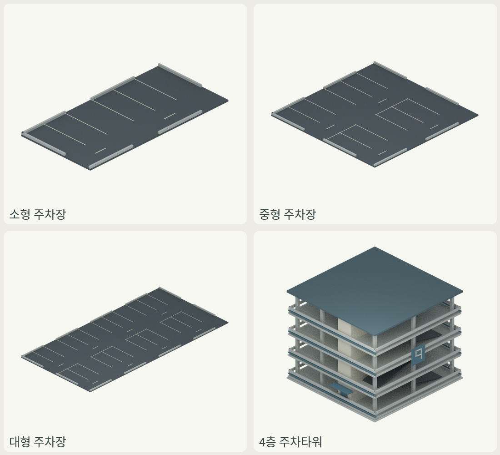
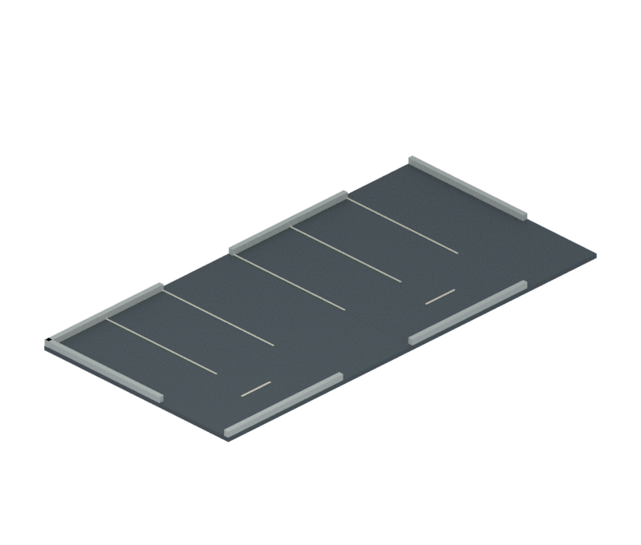
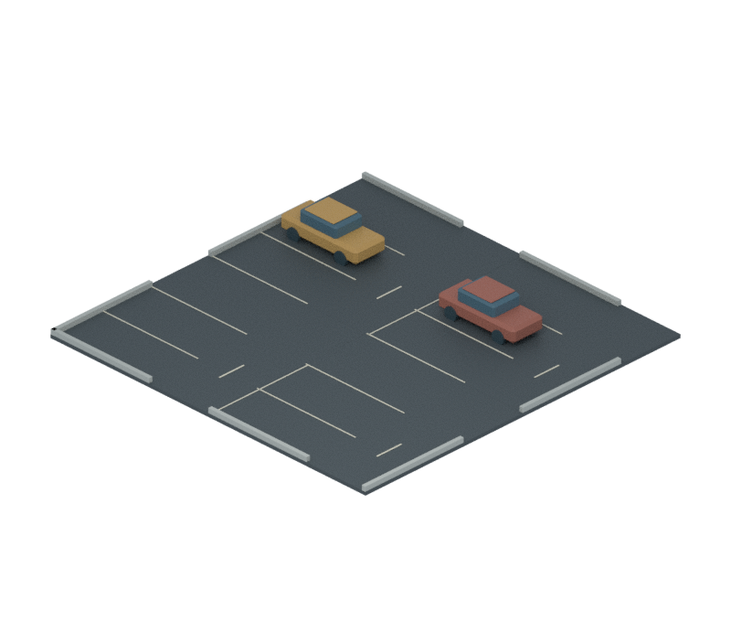
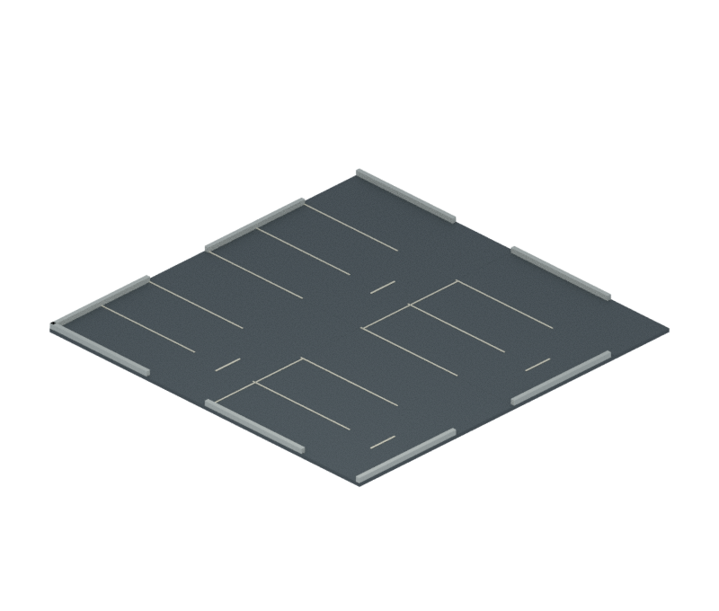
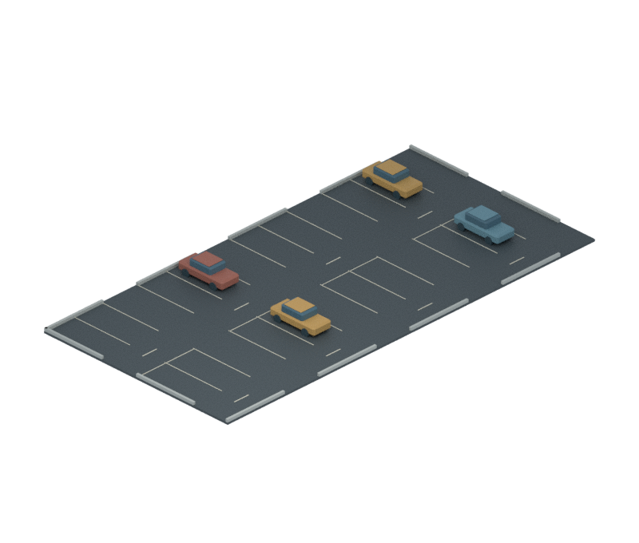
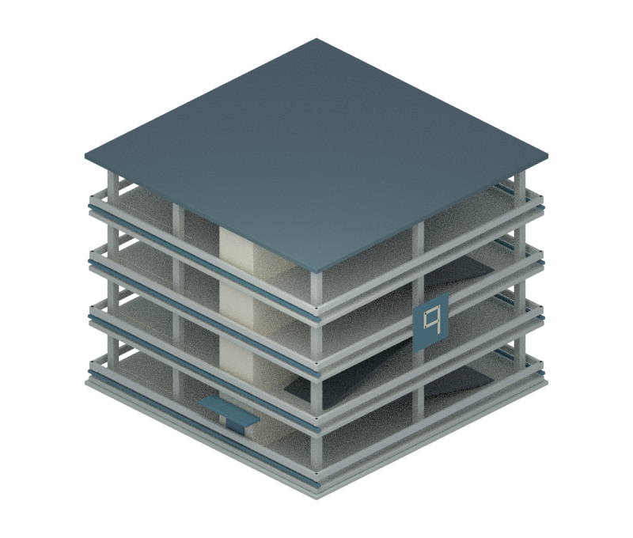

# 주차 시설4종 · 주차 차량만 제거

브랜치 `assets/empty-parking-20261112`, 기준 main `d4530e6`. 사용자 요청대로 차량 장식만 제거했다.
게임 통합과 main 병합 없이 원본 애셋/미리보기 및 원본 폴더의 GLB를 별도 브랜치에 보존한다.

| 시설 | 부지(칸) | 부지(m) | 주차면 수 유지 | 제거 차량 / 메시 | 나머지 보존 메시 |
|---|---|---|---:|---:|---:|
| parking-small-2x4 | 2×4 | 8×16 | 4 | 1대 / 7 | 18 |
| parking-medium-4x4 | 4×4 | 16×16 | 8 | 2대 / 14 | 32 |
| parking-large-4x8 | 4×8 | 16×32 | 16 | 4대 / 28 | 60 |
| parking-tower-4x4-4f | 4×4 | 16×16 | 16 | 8대 / 16 | 109 |

장식용 차량15대,65개 메시 객체를 제거했다. 주차면 수는 수용량이며 현재 주차된 장식 차량 수가 아니다.
타워는 주차층4개와 별도 지붕을 유지했다. 기존 출입구 캐노피/차양 오버행을 포함한 모든 구조는 원래대로다.

## 전후와 원본

### parking-small-2x4

[원본 blend·GLB·기존 spec](../../assets/facilities/parking-small-2x4/).

### parking-medium-4x4

[원본 blend·GLB·기존 spec](../../assets/facilities/parking-medium-4x4/).

### parking-large-4x8

[원본 blend·GLB·기존 spec](../../assets/facilities/parking-large-4x8/).

### parking-tower-4x4-4f

[원본 blend·GLB·기존 spec](../../assets/facilities/parking-tower-4x4-4f/).

## 보존 검증

- [차량 제거/보존36검사](validation.json): 제거 전후 나머지219메시의 평가 정점/토폴로지/법선/재질 노드 값/월드 변환/부모/렌더 숨김 해시가 완전히 일치한다.
- 삭제 대상은 평면의 ParkedCarBody/Cabin/Roof/Wheel과 타워의 CarBody/CarCabin뿐이다. 조명/차선/경계석/층/램프/기둥/계단실/P 표식은 바꾸지 않았다.
- 저장한 원본을 다시 열어 같은 해시로 검증했다. FacilityRoot의 좌표계/정면 변환과 spec.json 전체 바이트도 동일하다.
- 원래 카메라의800×680/30도 정투영/미터당 픽셀 값을 그대로 적용해 CPU Cycles24샘플로 실제 재렌더했다.
- [GLB16검사](glb-validation.json): 소스 폴더의 새 GLB4개를 다시 import해 삼각형 수·미터 경계·축 방향·유한성을 확인했다.
- [PNG4장](image-validation.json): RGBA·투명·원래 크기·잘림 없음. 검토표는 기존 Pillow/Noto 시스템 폰트로 원본 PNG를 배치/축소했으며 애셋 이미지는 변경하지 않았다.
- 기존 verify_facility_sources.py의 전체 공원/주차장8종도 SOURCE_CHECK True. 공원4종 원본·spec·카탈로그·레이아웃·가격·용량은 변경하지 않았다.
- 주차/램프 실제 차량 통과·게임 주행 AI·대량 성능·현재 게임 적용은 이번 검증에 포함하지 않는다.

## 변경 파일과 재현

- tools/build_facilities.py에서 차량을 배치하던 두 루프5줄만 삭제했다. 앞으로 이 제작기로 재생성해도 차량 장식은 생기지 않는다.
- tools/empty_parking_sources.py는 기존 원본에서 해당 객체만 지우는 이번 일회성 마이그레이션이다. 이미 빈 원본이면 중복 적용/전후 증거 덮어쓰기를 막기 위해 중단한다.
- 원래 제작기의 render 함수만 AST로 분리해 같은 스튜디오를 썼다. 전체 빌드 스크립트를 import/실행해 다른 애셋/게임을 재생성하지 않았다.
- 새 facility.glb는 assets/facilities/각ID/에 있다. 기존 cities_do/assets/facilities의 등록 GLB/PNG는 그대로이며 spec의 기존 res:// 경로도 바꾸지 않았다.
- 재검증: `blender -b --factory-startup -t 2 -P tools/verify_empty_parking.py`, `blender -b --factory-startup -t 2 -P tools/verify_facility_sources.py`.

적용 스킬: .agents/skills/cities-do-modular-facilities/SKILL.md의 미터/직사각 부지/주차4층/원본 보존 규약.
기존 build_vehicle_fleet/common.py 계열을 재사용한 원래 재질/메시를 유지했고, 새로운 외부 모델/텍스처/생성 서비스는 없다.
기존 상류 https://github.com/duolahypercho/zstack, 고정판74f7786e9931b9ced858a0e2df880f23e4c2430e, MIT.
assets/facilities/LICENSE-vehicle-MIT.txt 및 THIRD_PARTY_NOTICES.md를 그대로 보존했다. 새 도구/패키지/라이선스/에이전트 설치 없음.
이번은 새 시설/용량이 아니라 차량 장식만 없앤 수정이므로 기존 건설비/유지비/수용량을 그대로 유지한다.
