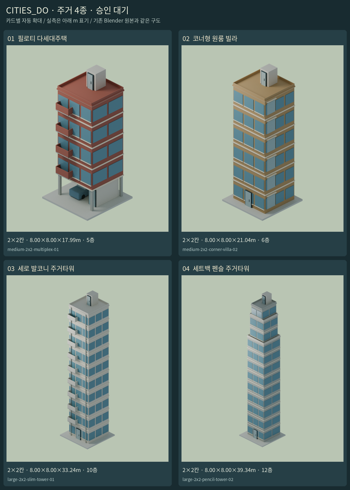
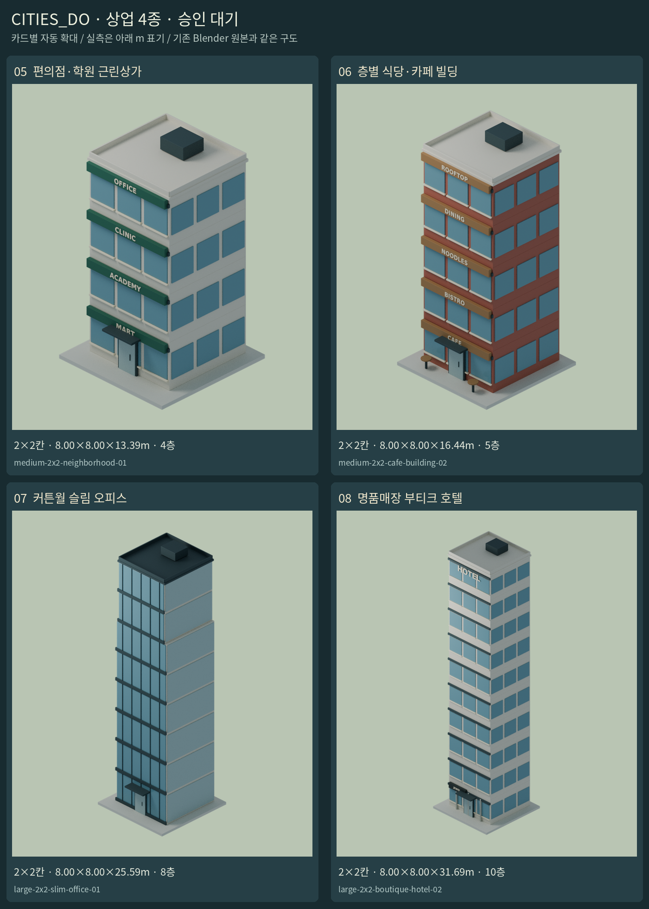
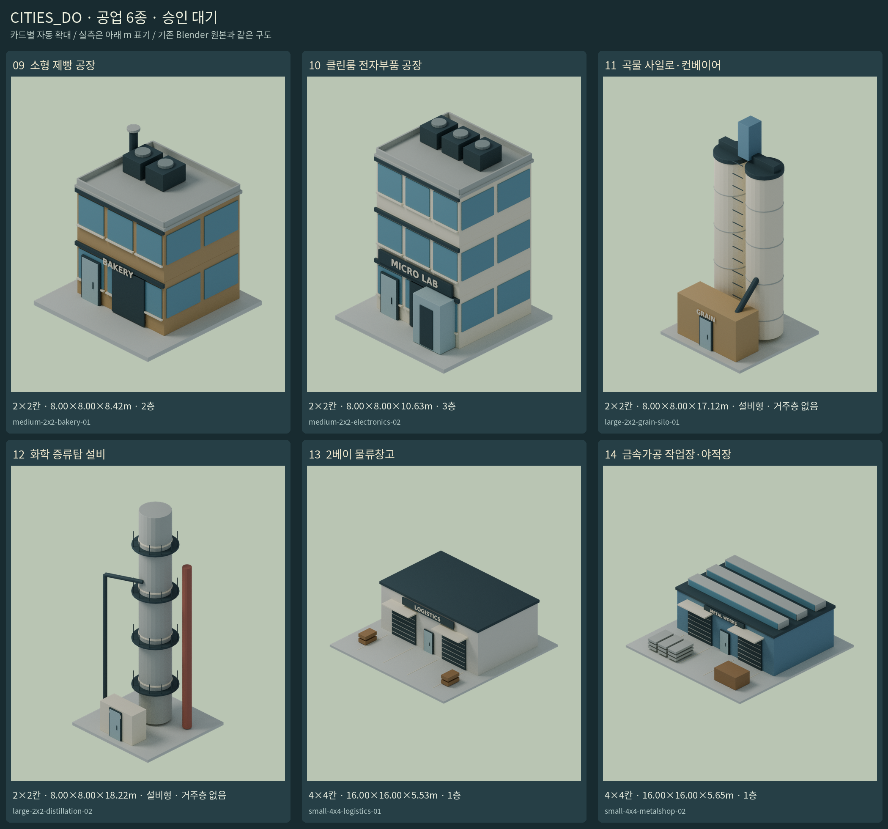

# 성장 건물 애셋 14종 · 검토 대기

**애셋 전용 브랜치 `assets/growth-14-20261111`. 게임 적용·성장 카탈로그 등록·main 병합 없음.**
사용자 수정: 소형·중형8×8 12종을 제외. 8×8은 성장5단계 최종 테크 전용이며 기존 대형8×8은 유지한다.
남은 주거4·상업4·공업6만 제작했다. 밀도와 필지 크기는 별개로 유지한다.

## 제작 방식

직접 작성 Blender 지오메트리, 시스템 DejaVu 폰트만 사용했다. 외부 모델/텍스처/생성형 이미지 없음.
Blender -Y 정면/+Z 위, Godot/glTF +Z 정면. metadata의 front는 Godot 기준, front_blender를 별도 표기한다.
기존 층고3.05m·바닥판 -0.12~+0.12m·상면0.12m·기존 저채도 팔레트·30도 정투영/방위각-45도 구도를 유지한다.
산업 설비의 층수0은 사일로·증류탑에 거주층이 없다는 뜻이다. 높이와 층수를 혼동하지 않는다.
원본 id.blend, building.png(900×1100 RGBA), metadata.json. 카드별 확대를 달리했으므로 아래 실측으로 비교한다.

## 시안

| 번호 | 이름 | 밀도 | 부지 | 실측 W×D×H(m) | 층수 | 원본·개별 이미지 |
|---|---|---|---|---|---|---|
| 01 | 필로티 다세대주택 | medium | 2×2 | 8.00×8.00×17.99 | 5 | [파일](../../assets/residential-growth/medium-2x2-multiplex-01) · [PNG](../../assets/residential-growth/medium-2x2-multiplex-01/building.png) |
| 02 | 코너형 원룸 빌라 | medium | 2×2 | 8.00×8.00×21.04 | 6 | [파일](../../assets/residential-growth/medium-2x2-corner-villa-02) · [PNG](../../assets/residential-growth/medium-2x2-corner-villa-02/building.png) |
| 03 | 세로 발코니 주거타워 | large | 2×2 | 8.00×8.00×33.24 | 10 | [파일](../../assets/residential-growth/large-2x2-slim-tower-01) · [PNG](../../assets/residential-growth/large-2x2-slim-tower-01/building.png) |
| 04 | 세트백 펜슬 주거타워 | large | 2×2 | 8.00×8.00×39.34 | 12 | [파일](../../assets/residential-growth/large-2x2-pencil-tower-02) · [PNG](../../assets/residential-growth/large-2x2-pencil-tower-02/building.png) |
| 05 | 편의점·학원 근린상가 | medium | 2×2 | 8.00×8.00×13.39 | 4 | [파일](../../assets/commercial-growth/medium-2x2-neighborhood-01) · [PNG](../../assets/commercial-growth/medium-2x2-neighborhood-01/building.png) |
| 06 | 층별 식당·카페 빌딩 | medium | 2×2 | 8.00×8.00×16.44 | 5 | [파일](../../assets/commercial-growth/medium-2x2-cafe-building-02) · [PNG](../../assets/commercial-growth/medium-2x2-cafe-building-02/building.png) |
| 07 | 커튼월 슬림 오피스 | large | 2×2 | 8.00×8.00×25.59 | 8 | [파일](../../assets/commercial-growth/large-2x2-slim-office-01) · [PNG](../../assets/commercial-growth/large-2x2-slim-office-01/building.png) |
| 08 | 명품매장 부티크 호텔 | large | 2×2 | 8.00×8.00×31.69 | 10 | [파일](../../assets/commercial-growth/large-2x2-boutique-hotel-02) · [PNG](../../assets/commercial-growth/large-2x2-boutique-hotel-02/building.png) |
| 09 | 소형 제빵 공장 | medium | 2×2 | 8.00×8.00×8.42 | 2 | [파일](../../assets/industrial-growth/medium-2x2-bakery-01) · [PNG](../../assets/industrial-growth/medium-2x2-bakery-01/building.png) |
| 10 | 클린룸 전자부품 공장 | medium | 2×2 | 8.00×8.00×10.63 | 3 | [파일](../../assets/industrial-growth/medium-2x2-electronics-02) · [PNG](../../assets/industrial-growth/medium-2x2-electronics-02/building.png) |
| 11 | 곡물 사일로·컨베이어 | large | 2×2 | 8.00×8.00×17.12 | 0 | [파일](../../assets/industrial-growth/large-2x2-grain-silo-01) · [PNG](../../assets/industrial-growth/large-2x2-grain-silo-01/building.png) |
| 12 | 화학 증류탑 설비 | large | 2×2 | 8.00×8.00×18.22 | 0 | [파일](../../assets/industrial-growth/large-2x2-distillation-02) · [PNG](../../assets/industrial-growth/large-2x2-distillation-02/building.png) |
| 13 | 2베이 물류창고 | small | 4×4 | 16.00×16.00×5.53 | 1 | [파일](../../assets/industrial-growth/small-4x4-logistics-01) · [PNG](../../assets/industrial-growth/small-4x4-logistics-01/building.png) |
| 14 | 금속가공 작업장·야적장 | small | 4×4 | 16.00×16.00×5.65 | 1 | [파일](../../assets/industrial-growth/small-4x4-metalshop-02) · [PNG](../../assets/industrial-growth/small-4x4-metalshop-02/building.png) |

## 재현·검증

`blender -b --factory-startup -t 6 -P tools/build_growth_14.py` (선택 `-- --only ID`).
`blender -b --factory-startup -t 2 -P tools/verify_growth_14.py` 후 `python tools/build_growth_14_review.py`.
geometry-validation.json: 14개 원본을 다시 열어 평가된 메시/폰트 전체 부지 경계·실측·정면·층수·카메라를 확인한다.
image-validation.json: PNG 크기/알파/프레임 잘림과 SHA-256. 실제 렌더링과 기하 검사는 별도다.
새 게임 기능·경제 적용·실내·LOD·충돌·구조공학 검증은 하지 않았다. 승인 전 game_registered=false를 유지한다.
[가격·용량 제안](BALANCE_PROPOSALS_KO.md)은 미적용이다. 모델을 만들었다고 이 값을 승인된 경제로 쓰지 않는다.

## 간판 부분 수정

[10·13·14번 간판 위치/대비 수정과 전후 검증](SIGN_FIX_KO.md). 다른11종은 그대로 유지했다.
