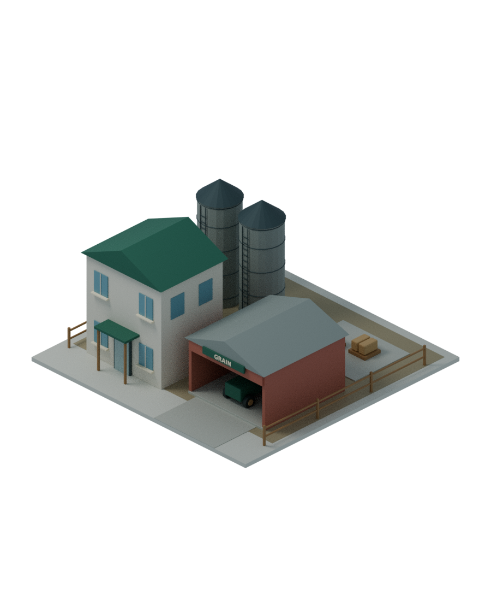
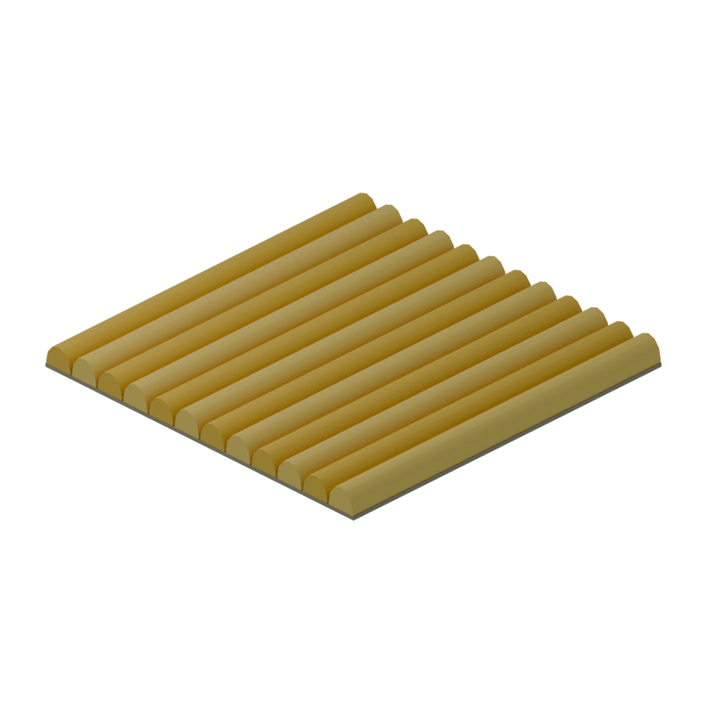

# 1차 산업 애셋 · 곡물 농장과 작업지10종

[최신 철·석탄 광산 실루엣 분리](mine-silhouettes/README_KO.md).

**현재 최종 작업:** [메인8종 완성·연결형 광산 바닥·목초지3변형](completion/README_KO.md). 전체 메인9+작업지12=21종. 아래는 이전 단계 기록이다.

**최신 사용자 결정:** 곡물밭은6afefd8의 매끈한140삼각형 버전으로 정확히 복원했다.
[추가 작업지9종/실측/3×3/복원 검증](work-tiles/README_KO.md)을 완료했다.
메인8종은 이번 작업지 요청 범위가 아니므로 제작하지 않았다. 아래 첫 쌍 설명은 최초 단계의 기록이다.


브랜치 `assets/primary-industry-20261112`, 기준 main `d4530e6`. 요청서5절의 먼저 확인받는 한 쌍만 제작했다.
[첨부 요청서 원문](REQUEST_REFERENCE_KO.md)은 참고 문서이며 기존 합의를 덮어쓰는 지시가 아니다.
이 시안의 톤·축척 확인 후 채소/축산/임업/광업/석유/어업 나머지를 만든다.
제목은9+9이지만 유정 타일의 펌프잭 없는 변형까지 세면 **메인9+타일10=19종**, 이번2종 이후17종이다.

| 애셋 | 부지 | 실측 W×D×H(m) | 최고점 / 최저점 z | 층수 | 평가 삼각형 |
|---|---|---|---|---|---:|
| 곡물 농장 | 4×4칸 | 16×16×7.68 | 7.56 / −0.12m | 농가2·차고1·사일로 설비 | 14,704 |
| 곡물 밭 | 1×1칸 | 4×4×0.86 | 0.74 / −0.12m | 0 | 140 |

H는 바닥판까지 포함한 전체 메시 경계다. 밭 지표는z=0이며 흙바닥은−0.12m까지다.
농가 층고3.05m, 바닥 기준.12m. 모든 외장·울타리·마당·작물은 부지 안이다.
메인 건물용 삼각형 상한은 요청서에 없으며 밭은 사용자 후속 요청에 따라 기존300개 하한보다 낮춘140개다.

## 곡물 농장


2층 농가·별도 트랙터 차고·곡물 저장 사일로2기·사다리·포대 하역장·전면 진입 마당.
출입문과 차고 입구는 Blender −Y를 향한다. 지붕·벽·간판은 기존 시리즈 팔레트와 기하를 썼다.
[원본/metadata](../../assets/primary-industry/primary-farm-grain-01/).

## 곡물 밭 · 단일 타일


폭0.94m의 둥근 황금색 작물 띠4개, 높이0.70~0.74m. 개별 줄기/이삭 없이 고랑 폭0.06m만 남겼다.
[이번 단순화의 전후·100칸·검증](grain-ribbons/README_KO.md). 외곽 테두리·울타리 없음.
[원본/metadata](../../assets/primary-industry/primary-tile-grain-01/).

## 3×3 실제 연결


한 타일을4m 간격으로 정확히9개 복제했다. 이미지 이어붙이기나 가짜 격자 오버레이가 아니다.
서로 마주 보는 X/Y 경계의 (접선 좌표,z,재질) 정렬 집합이 일치하며 이랑은Y방향 경계까지 이어진다.
이랑 간격 X=1m, 작물 띠는Y방향으로 연속이다. 양쪽 경계의 단면과 조명 법선이 일치한다. 반복 문양은 의도된 규칙적인 재배 패턴이다.
네 변의 바닥 높이와 재질이 같고 렌더에서 내부 경계의 틈/테두리가 보이지 않는 것을 확인했다.
매설된 타일 옆면은 개별 메시로 남는다. 병합 최적화나 단일 드로콜을 검증한 것은 아니다.

## 기존 방식 우선 적용

- 1칸=4m, 메인4×4칸, Blender −Y 정면/+Z 위, Godot +Z 정면을 유지했다. 요청서와 이 부분 충돌 없음.
- 요청서의 **1×1 작업지**는 일반 성장 건물2×2/4×4/8×8의 예외 크기가 아니라 별도의 `primary_work_tile` 종류다. 성장 건물의 후보로 넣지 않는다.
- 8×8은 성장5단계 전용 규칙을 유지하며 이번에 사용하지 않았다.
- 기존의 바닥판±0.12m를 메인에 쓰고, 밭은 지표0/바닥−.12m로 정확하게 맞췄다. 위에서 본 투명 배경과30도 정투영 구도를 유지했다.
- 작업지 자동 확장/도로·건물과 겹친 칸 삭제는 첨부된 **향후 게임 동작 설명**이다. 이번에는 원본 애셋만 만들었고 게임 로직·배치 UI·카탈로그를 바꾸지 않았다.
- 메인 직접 배치 산업의 소유/요금 정책은 아직 확정하지 않았다. 민간 구획 자동 신축에 시정부 요금을 임의로 부과하지 않는다.

## 이번 실행한 검증과 재현

- Blender4.3.2 CPU Cycles48샘플. 외부 모델·외부 텍스처·생성형 이미지/API 사용 없음.
- 기존 `tools/build_growth_14.py`를 import해 재질/box/tube/bar/text/door를 재사용했고 해당 원본은 수정하지 않았다.
- 현재 프로젝트의 `cities-do-construction` 부지/방향 규약 적용. 외부 스킬을 새로 설치하거나 원래 도구 전체 파이프라인을 실행했다고 주장하지 않는다.
- 시스템 DejaVu Sans Bold 폰트를 blend에 pack했다. [폰트 라이선스](../../assets/primary-industry/DEJAVU_FONT_LICENSE.txt).
- [기하48/48](geometry-validation.json): 원본 재개방, 단위/유한성/부지 전체/실측/삼각형, 카메라30도/크기/프레임, 사일로2개·출입문/차고 정면, 밭 경계 단면/음영 법선·이랑 주기·고랑 폭/피복률·타일 예산.
- [PNG21개](image-validation.json): 실제 디코딩, 지정 크기, RGBA, 투명 영역, 프레임 잘림 없음.
- [최초 빌드 로그](build-initial.log)의 밭1,140삼각형은 중간 시안이다. [최종 밭 로그](build-tile.log)는 첫 시안1,464삼각형이며, [현재 수정 빌드](grain-ribbons/build.log)는140삼각형이다. Blender 설정 캐시의 읽기전용 경고는 로그에 보존했으며 렌더/원본 저장은 성공했다.
- 게임 자원 시스템·자동확장·삭제·주행·충돌·고저차·대량 타일 성능·GLB 변환·통합 동작은 미검증이다.

```sh
blender -b --factory-startup -t 4 -P tools/build_primary_industry.py
# 한 종만 다시 만들기: -- --only primary-farm-grain-01 또는 primary-tile-grain-01
blender -b --factory-startup -t 2 -P tools/verify_primary_industry.py
```

## 가격·용량 제안 · 미승인/미적용

아래는 **메인 농장을 공공 매입하는 경우**의 검토안이다. 실제 소유/요금 정책은 미정이며,
민간 구획 자동 신축으로 결정하면 기존 확정 규칙대로 시정부 건설비/유지비0이며 이 공공안은 폐기한다.
기존 소형 소방서8,000/월120·진료소6,000/월100 제안/임시 수치와 비교한 소형 저층 산업 거점 초안이다.

| 애셋 | 1회 건설비 제안 | 유지비 제안 | 50,000doth 자금 영향 |
|---|---:|---:|---|
| 곡물 농장 메인 | 6,000doth/시설 | 80doth/게임월 | 12%; 자동 차감하지 않음 |
| 곡물 밭 | 0doth/칸 | 0doth/(칸·게임월) | 자동 확장 칸에 추가 시정부 요금 없음 |

곡물 농장 거점은 최대 작업지32칸을 관리하고 종사자8명, 반입/출하 처리 상한.25톤/게임일을 제안한다.
사일로2기는 합계30톤 저장 제안(생산량이 아님). 타일당 정격 수확 환산.006톤/게임일, 평균.004톤/게임일이다.
실제 생산 제안은 `min(유효 작업지 수 × 타일 생산률, 거점 처리 상한)`이며 거점 처리량을 작물 생산에 더하지 않는다.
32칸 평균은.128톤/게임일, 정격은.192톤/게임일이다. 농업 계절은 아직 구현하지 않았으며 연간 수확을 게임일에 평균한 추상 수치다.
거점 자체 전력 평균8kW·용수1m³/게임일·하수.8m³/게임일·생활 잔재.002톤/게임일,
타일당 추가 관개.02m³/게임일·비료.001톤/게임일·전력0kW·작물 잔재.001톤/게임일을 제안한다.
작물 잔재는 비료/퇴비 또는 처리 경로가 필요하며 생산 시 임의 소멸시키지 않는다. 수확 후 사일로 만재 시 반입 정지,
자원/계절·관개·인력·도로/수송이 병목이다. 유지비에 포함된 인건비·연료를 후속 요금에서 중복 부과하지 않는다.
가격·용량·자체 수요 모두 시안 검토용이며 기존 경제 CSV/실행 수치를 바꾸지 않았다.
