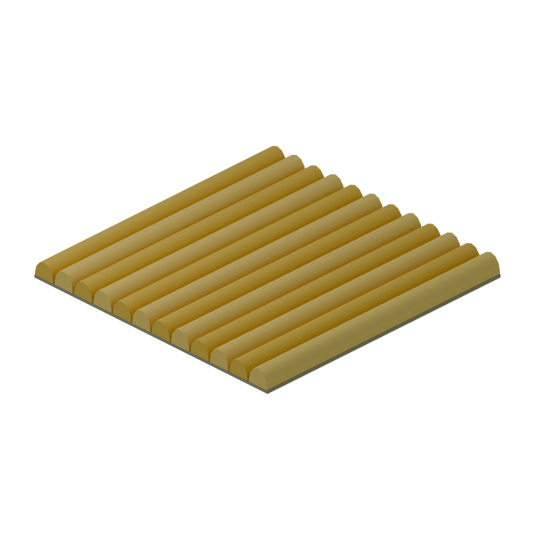
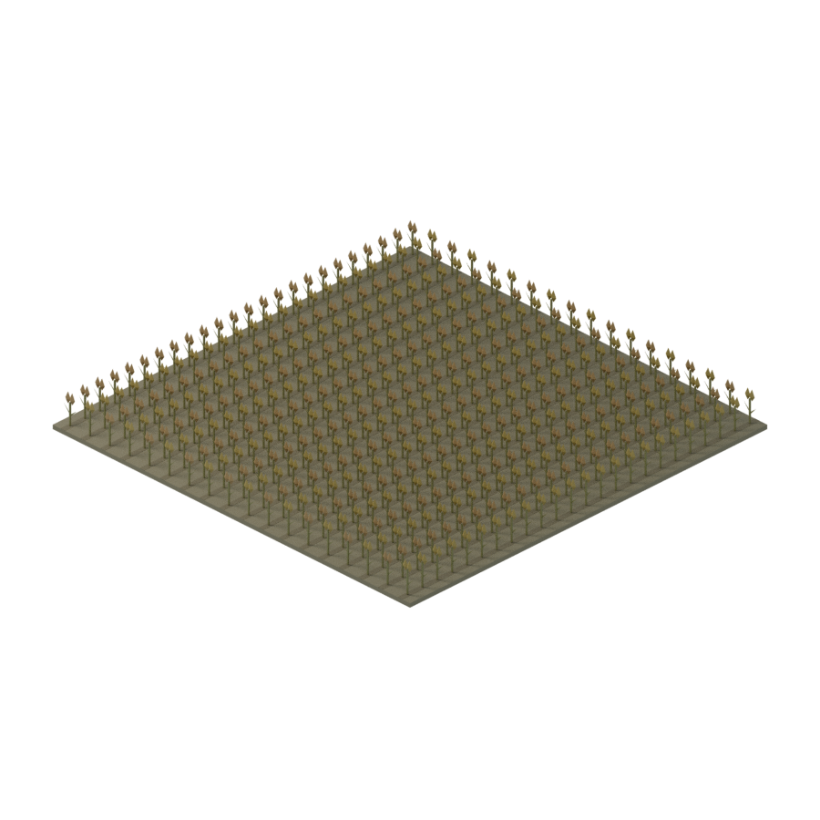
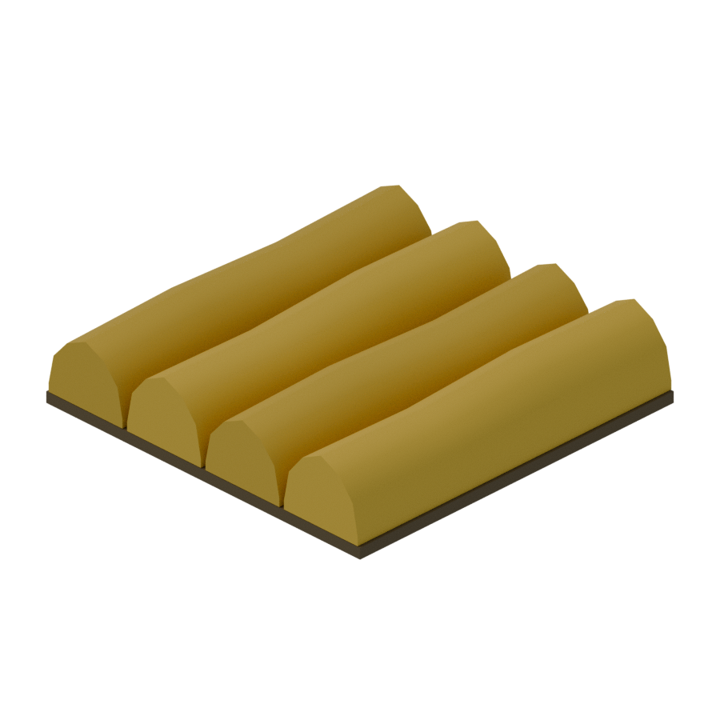
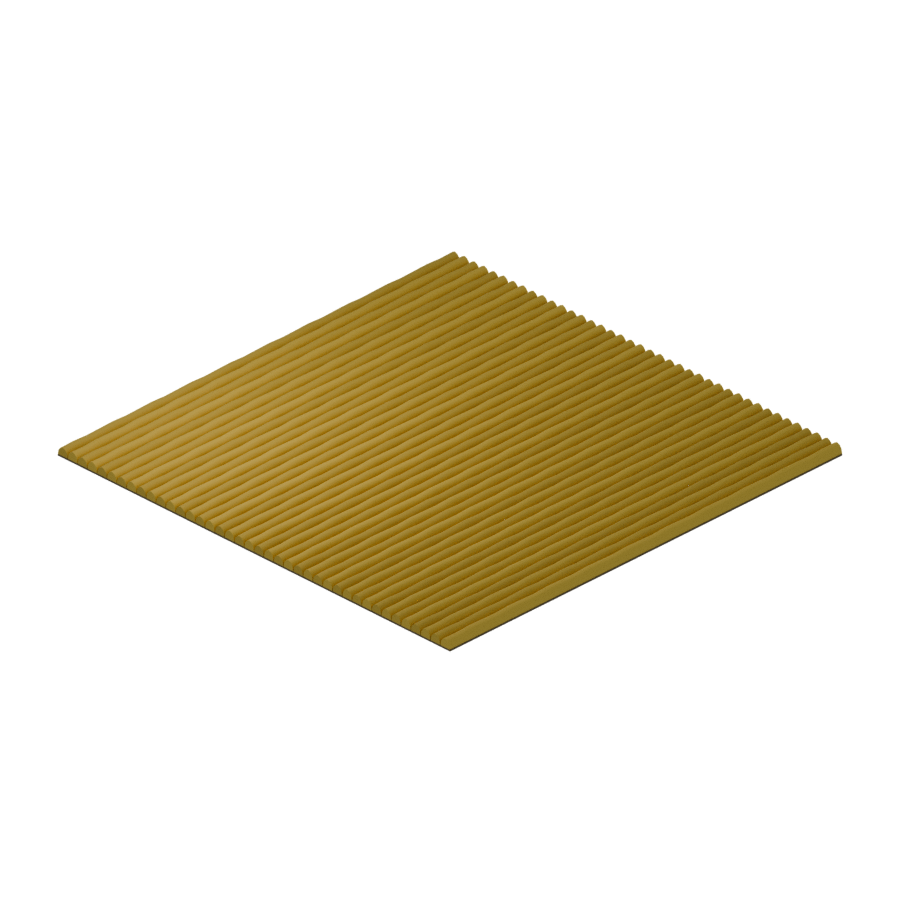

# 곡물 밭 · 이랑 단위 덩어리형 수정

사용자 요청: 개별 작물 대신 낮고 둥근 황금색 띠, 높이0.6~0.8m, 좁은 고랑과 적은 흙 노출,
멀리서 밀밭으로 읽히는 밝은 밀색, 반복 배치를 위한 낮은 삼각형 수. 이번 수정은 밭 타일만 바꿨다.

| 항목 | 이전 | 현재 |
|---|---|---|
| 표현 | 개별 줄기/이삭/잎48지점 | 연속 작물 띠4개 |
| 규격 | 4×4m | 4×4m 유지 |
| 지표 위 최고점 | 0.96m | 0.678~0.798m |
| 바닥 포함 높이 | 1.08m | 0.918m |
| 삼각형/칸 | 1,464 | 284 (원래 개별 작물 대비80.6% 감소) |
| 메시 객체/칸 | 199 | 5 (바닥1+작물 띠4) |
| 이랑 간격/작물 폭/고랑 | 개별 재배 패턴 | 1.00m / 0.94m / 0.06m |
| 상부에서 작물 피복 | 성긴 개체 | 94%; 흙 고랑6% |

## 후속 요청: 이삭 끝 굴곡·밝기·고랑

- 각 띠를Y방향4단면/3구간으로 나눠0,+4cm,−4cm,0의 낮은 물결을 줬다. 홀수 이랑은 위상을 반전했다.
- 횡단면에는0,+.8,−1.2,+1.8,−1.2,+.8,0cm의 얕은 톱니를 넣었다. 개별 이삭 메시/텍스처가 아니다.
- 이랑별 기본 황금색의 선형 RGB를.92/1.06/.97/1.10배했다. 색상비를 유지해±10% 범위의 명도 변화를 준다.
- 고랑 바닥은#786342의 짙은 흙색이다. 이랑 피복94%/고랑6cm/메시5개는 그대로다.
- 완전히 매끈한 직전 버전은140삼각형, 이번 굴곡 버전은284삼각형으로300개 이하를 만족한다.
- 타일 경계의 높이와 기하 접선이 같고, 상부에 가로 이음선이 보이지 않는 것을 실제3×3·100칸 렌더에서 확인했다.

## 3×3 수정 전후

## 100칸 원거리 검토

실제 타일100개를4m 간격으로 배치했다. 확대/축소나 이미지 합성 없음. 연결된 메시 데이터를 공유한다.
100칸의 단순 기하 합계는28,400삼각형(이전146,400), 300칸은85,200(이전439,200)이다.
이 숫자는 원본 기하의 산술 합계다. Godot에서 배치/인스턴싱/병합을 구현하거나 FPS·메모리 성능을 측정한 것은 아니다.

## 연결과 검증

- 작물 띠를 같은 단면으로Y=-2~+2m까지 연장했다. 네 변의 바닥 높이/재질과 상대 경계 단면이 일치한다.
- 표면의 커스텀 루프 법선은서로 같은 목표 법선으로 두어 숨겨지는 끝 마개가 상부 음영에 가로 이음선을 만들지 않게 했다.
- X 이랑 중심 간격1m는 타일 경계를 건너도 같다. 노출되는 작물 옆면과 좁은 고랑은 의도된 이랑이다.
- 원본 재개방·부지·정면·카메라·단면·법선·피복률·물결 높이·밝기 범위/재질·고랑 대비·284삼각형 등을52/52 검사 통과했다.
- 경계 법선은 Blender가 로컬 팬 공간에 양자화해 저장하므로 소수점 문자열 동일성 대신 디코딩 각도 오차를 검사한다.
  목표 법선은 같고 실제 경계 법선 오차와0.10도 허용값을 geometry-validation.json에 기록했다. 경계 위치/재질 단면은 엄격히 일치해야 한다.
- 단일/3×3 PNG를 실제 CPU Cycles48샘플로 렌더, 100칸은32샘플. 시스템/폰트/원래 스킬 출처는 상위 보고서 그대로다.
- 기존 농장 원본/PNG/metadata는 바이트 보존. 가격/용량 제안, 게임/성장/카탈로그, 다른17종은 수정하지 않았다.
- 외부 텍스처/모델/생성형 이미지 없음. 초기 요청의300개 하한은 최신 사용자 요청의300개 이하 경량화 우선으로 대체했다.

재현: `tools/build_primary_industry.py -- --only primary-tile-grain-01`,
`tools/verify_primary_industry.py`, `tools/render_grain_field_review.py`를 Blender headless에서 실행.
