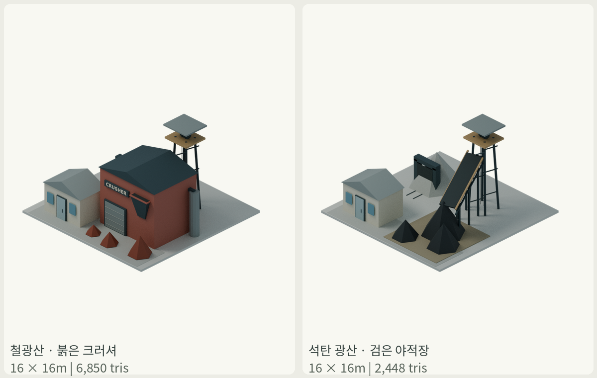
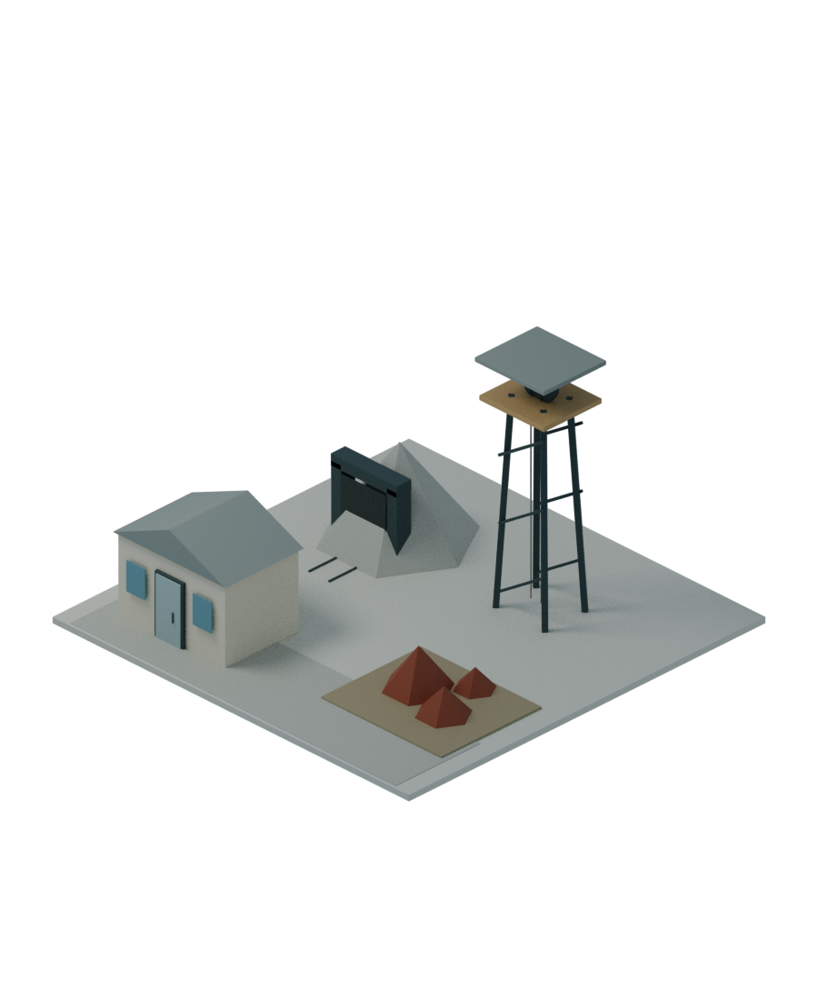
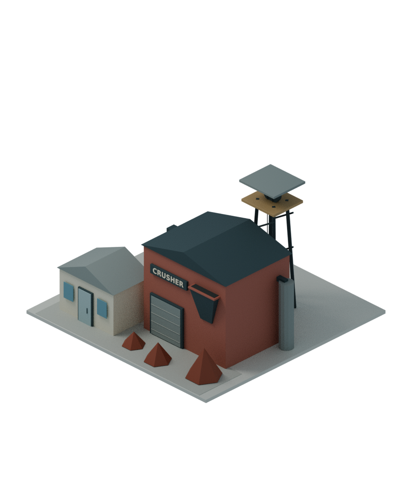
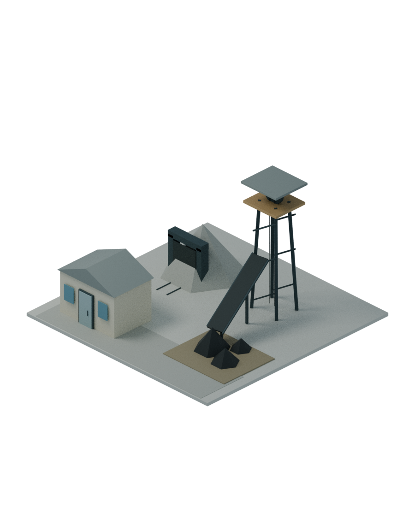

# 철·석탄 광산 실루엣 분리

사용자 요청대로 같은 권양탑과 작은 광석 더미에 의존하던 두 메인 광산을 서로 다른 덩어리로 바꿨다.
브랜치 assets/primary-industry-20261112. 작업지 타일이나 다른 시설은 변경하지 않았다.

| 시설 | 현재 중심 형태 | 실측 W×D×H(m) | 삼각형 |
|---|---|---|---:|
| 철광산 | 넓고 높은 붉은 크러셔 건물·투입 호퍼·집진 설비·붉은 광석 더미 | 16×16×9.4 | 6,850 |
| 석탄 광산 | 높이3.7m급의 큰 검은 석탄 더미3개·넓고 높은 컨베이어 | 16×16×9.4 | 2,448 |

철광산의 크러셔는6.10m 높이의 기계 설비 공간이다. 기존 사무동1층/층고3.05m, 갱구와 권양탑은 유지했다.
석탄 컨베이어는 폭1.85m의 벨트, 측면 프레임·하부 보·롤러·지지대를 갖는다. 장비 작동/실제 처리 능력은 구현하지 않았다.

## 전후

철광산 이전:

철광산 수정:

석탄 광산 이전:

석탄 광산 수정:

## 유지한 규격과 이번 검증

- 두 원본 모두4×4칸/16×16m, Blender−Y 정면/+Z 위, Godot+Z 정면, 바닥판±0.12m, 최고점9.28m/바닥 포함 높이9.4m를 유지한다.
- 모든 건물·광석·장비는 부지 안에 있다. 기존 갱구/사무동/권양탑은 그대로이며 철광산 전면은 크러셔가 시각적으로 지배하도록 했다.
- [메인8종156검사](../completion/main-geometry-validation.json): 저장한 원본 재개방, 부지/측정/방향/층고/카메라/투명/삼각형,
  철 크러셔·호퍼·집진기·폰트 pack, 석탄 큰 야적/넓은 벨트/크러셔 없음 등 검사를 통과했다.
- [다른19애셋90파일](preserved-assets.json)은 직전 fd38caf와 바이트 동일이다. 곡물·목초지·철/석탄 작업지와 다른 메인6종은 그대로다.
- 두 preview.png를 원래900×1100/30도 정투영/투명 배경의 CPU Cycles48샘플로 실제 재렌더했고 현재 PNG 검사를 갱신했다.
- CRUSHER 글자는 기존 시스템 DejaVu Sans Bold를 사용해 blend에 pack했다. 기존 assets/primary-industry/DEJAVU_FONT_LICENSE.txt를 유지한다.
- 기존 build_primary_main.py의 mine 분기와 verify_primary_main.py만 확장했다. 기존 내부 construction/primary/growth helper를 유지했고 새 스킬/상류/패키지/에이전트는 없다.
- 외부 모델/텍스처/생성형 이미지/API 없음. 비교판은 실제 렌더 PNG를 배치·축소한 보고서용 이미지다.
- 기존 가격/용량 제안·작업지 수확률·성장·경제 CSV·게임 코드/카탈로그·주차 브랜치는 변경하지 않았다.
- GLB 변환/게임 적용/분쇄·컨베이어 작동·생산/차량 AI/성능/main 병합은 이번 범위가 아니다.

재현: `tools/build_primary_main.py -- --only primary-mine-iron-01` 또는 `primary-mine-coal-01`을 Blender headless에서 실행,
`tools/verify_primary_main.py`로 검증한다. 나머지 원본은 재생성하지 않았다.
