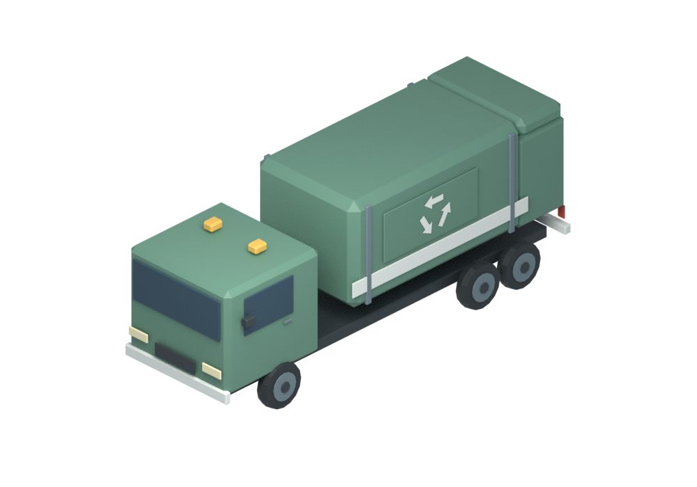
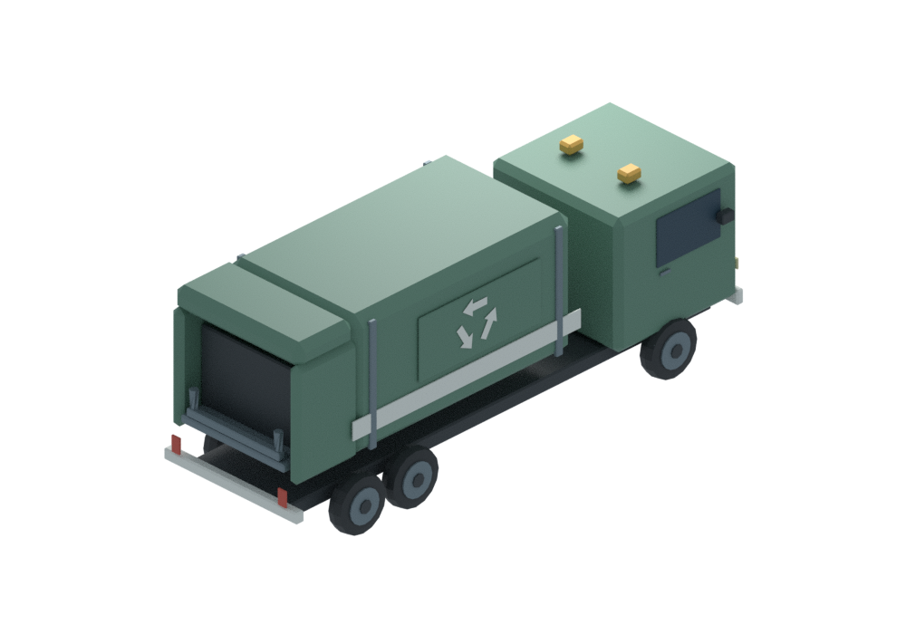
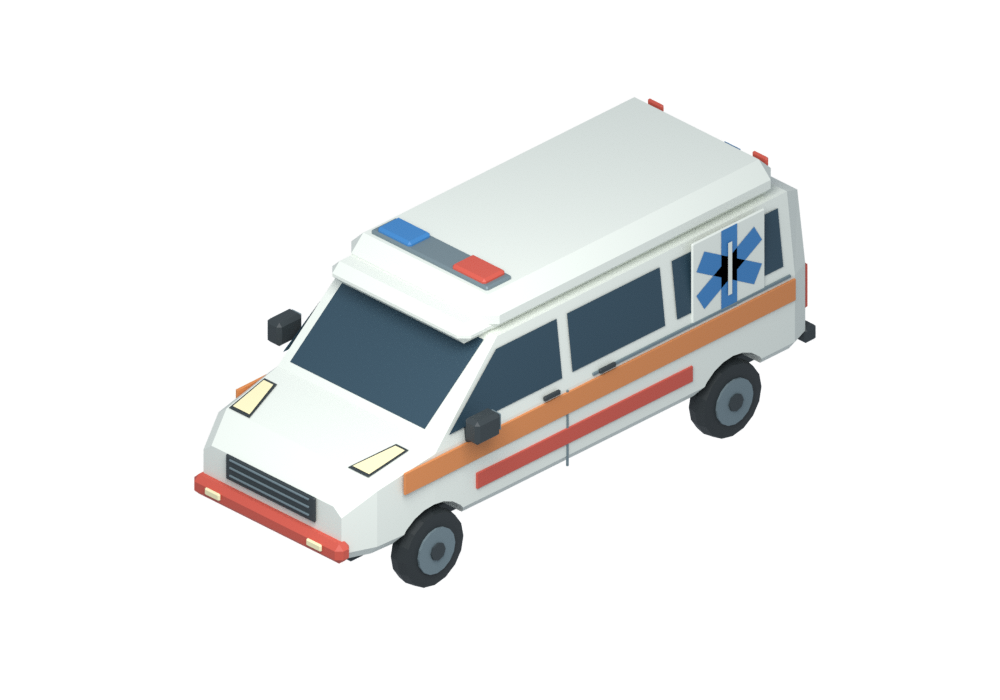
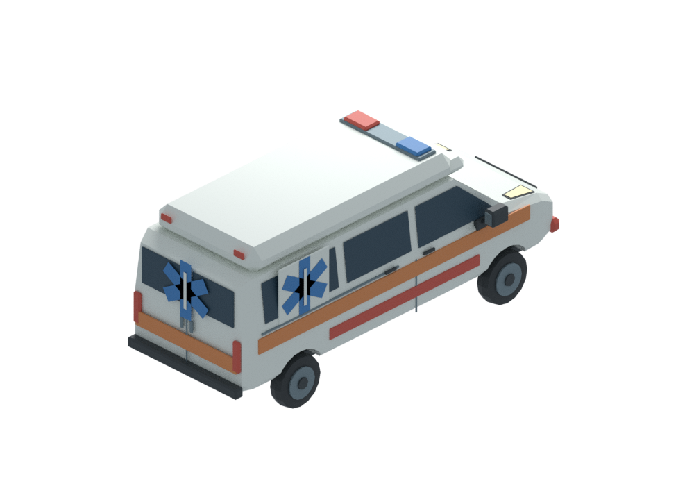
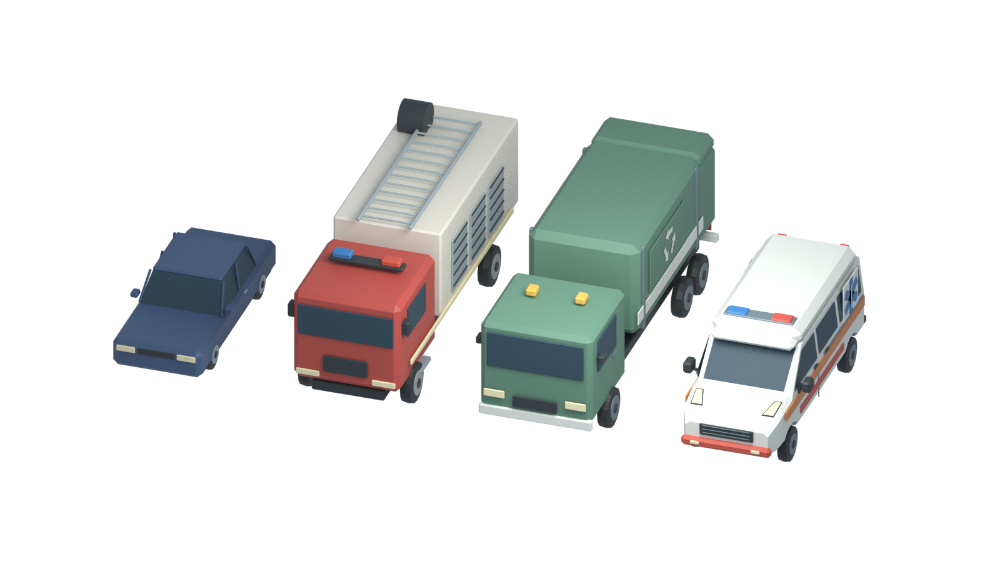

# 서비스 차량2종 · 원본 애셋 전용

브랜치 `assets/service-vehicles-2-20261111`. 게임 코드/기존 차량/카탈로그 변경, GLB/8방향 스프라이트 생성, main 병합 없음.
쓰레기차를 먼저 완성하고 구급차를 제작했다. 둘 다 브랜드를 복제하지 않은 가상 차량이다.

| 차량 | 명목 L×W×H(m) | 부속품 포함 실측 L×W×H(m) | 삼각형 | 전체 높이 제한 |
|---|---|---|---|---|
| 쓰레기차 | 8.00×2.45×3.20 | 8.11×2.70×3.14 | 3,186 | 3.3m |
| 구급차 | 5.90×2.10×2.60 | 6.02×2.68×2.60 | 3,326 | 3.4m |

실측에는 미러·범퍼·등화·후면 장치를 포함한다. 명목 너비와 실측 너비를 혼동하지 않는다.
구급차는 실제 최고점2.60m로 차고 높이3.4m 미만, 쓰레기차는3.145m로 권장3.3m 미만이다.

## 쓰레기차

녹색 압축식 적재함·흰 띠·직접 만든 재활용 화살표·후면 투입부·리프트 암과 별도 BinLiftPivot. 압축/리프트 작동은 미검증이다.

## 구급차

한국 구급차 레퍼런스의 연속 승합형 차체·박스형 환자실과 높인 지붕·주황/빨강 반사띠·적청색 지붕 경광등·측면/후면 기하학 Star of Life 의료 표식.
의료 표식은 60도 간격의3개 막대로 만든6방향 별과 중앙 지팡이이며 이미지 텍스처가 아니다.

[구급차 수정 전후·미러 연결 확대 검수](ambulance-revision/README_KO.md).

## 기존 차량과 같은 물리 축척

왼쪽부터 기존 중형 세단(명목4.85m), 소방차(7.6m), 새 쓰레기차(8.0m), 새 구급차(5.9m). 원본을 확대/축소하지 않고 위치만 옮겼다.

## 제작·검증

- 원본 tools/build_vehicle_fleet.py는 수정하지 않고 새 tools/build_service_vehicles_2.py가 기존 helper를 import한다.
- 기존 common.py empty/parent_keep/rounded_box/revolve 규약과 기존 바퀴·운전석 조립 함수를 재사용했다.
- 상류: https://github.com/duolahypercho/zstack, 74f7786e9931b9ced858a0e2df880f23e4c2430e, MIT. 각 원본 폴더의 ZSTACK_LICENSE.txt.
- 외부 모델·텍스처·생성형 이미지·API 없음. 모든 표식도 직접 스크립트 지오메트리다.
- Blender4.3.2에서 미터·유한 평가 메시·타이어 접지·좌측 운전석/운전대·바퀴 피벗·full accessory height·실측/삼각형 일치 등을39항목 검사했다. 양쪽 미러의 차체/받침/연결 암/하우징 접촉6항목을 포함한다.
- 1000×700 RGBA PNG4장의 디코딩·내용·투명 배경·프레임 잘림을 확인했다.
- 원본7.6m 소방차/4.85m 세단과 실제 동일 축척 렌더는 별도이며 게임 주행/차고 진입 테스트가 아니다.
- 전체 실사 IoU/문개폐/충돌/환자이송/차량AI/대량 성능은 검증하지 않았다.

재현: `blender -b --factory-startup -t 4 -P tools/build_service_vehicles_2.py` (선택 `-- --only ID`),
`blender -b --factory-startup -t 2 -P tools/verify_service_vehicles_2.py`,
`blender -b --factory-startup -t 4 -P tools/render_service_vehicle_scale.py`.

## 비용·용량 제안 · 미적용

| 차량 | 시정부 구매비 제안 | 유지비 제안 | 용량·자체 수요 제안 |
|---|---|---|---|
| 쓰레기차 | 3,500 doth/대 | 55 doth/게임월 | 적재5톤·평균 수거3톤/게임일, 승무원2명, 연료30L/게임일 |
| 구급차 | 1,800 doth/대 | 30 doth/게임월 | 누운 환자1명+승무원2명, 6이송/게임일 정격·평균3이송, 연료18L/게임일 |

기존 소방차3,200/월45·운구차1,600/월25 제안과 비교한 초안이다. 50,000 doth 시작 자금의7%/3.6%를 각각 구매에 쓰는 제안이며 아직 차감하지 않는다.
게임월 유지비 청구 규칙과 연료망·수거/의료 엔진은 미구현/미확정이다. 시설 가격에 차량이 포함되면 중복 구매비를 부과하지 않는다.
적재5톤은 저장량이며 수거 처리량이 아니다. 쓰레기는 처리시설에 내려야 비워지고 수거자체가 잔재를 없애지 않는다.
구급차의 병원 도달·침상 여유·이송시간이 병목이며 차량 수만으로 치료용량을 늘리지 않는다. 자체 생활용수/소비전력은 차량에서 별도 건물부하로 임의 이중 계상하지 않는다.
