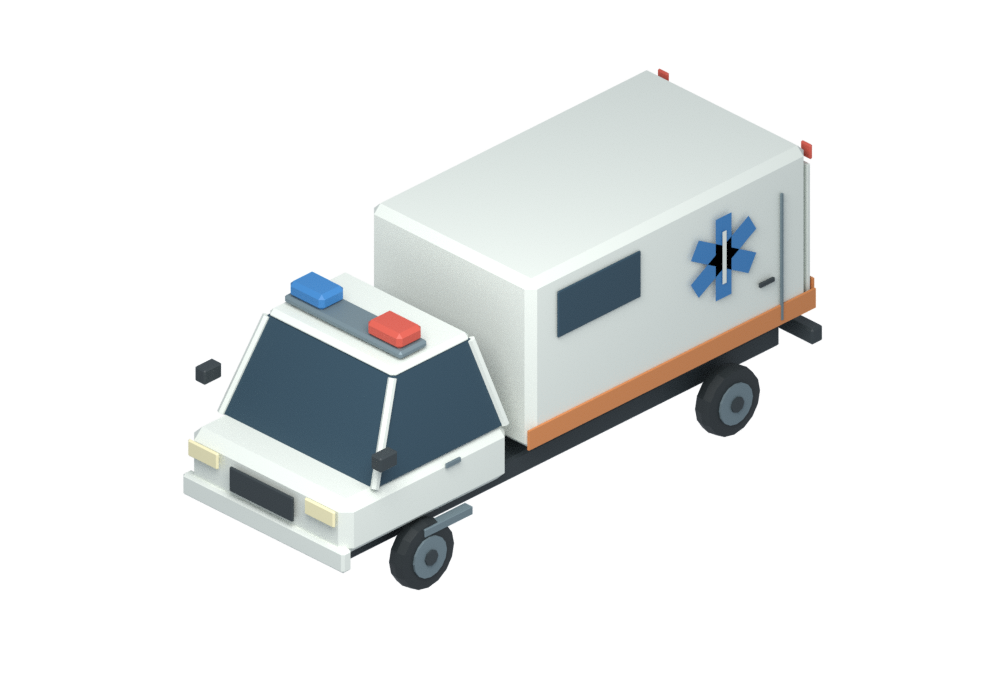
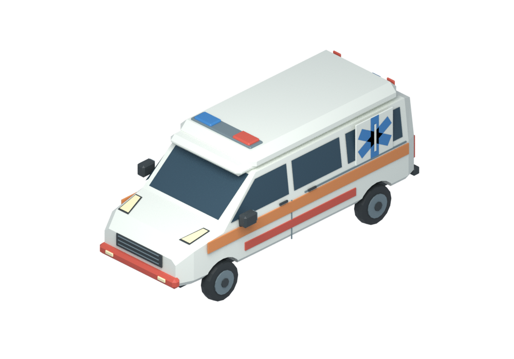
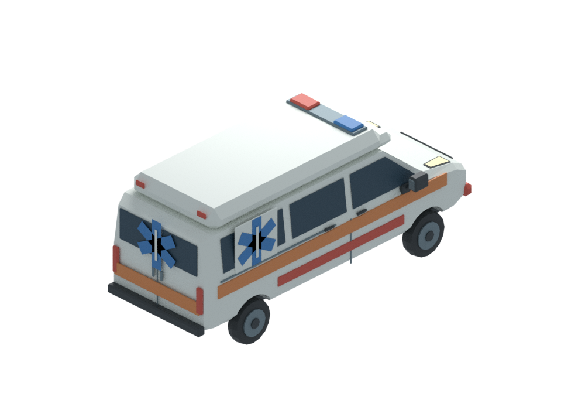
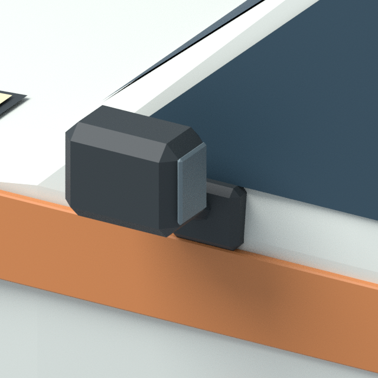

# 구급차 재제작 · 한국 승합형 레퍼런스

사용자가 기존 구급차의 공중에 뜬 사이드미러를 지적하고 한국 구급차 사진을 제공했다.
사진은 승합형 비율·앞유리/보닛 경사·높인 의료 지붕의 참고로만 사용했다. 실제 브랜드/로고/119 도색은 복제하지 않았다.
최초 요청의 가상 디자인·저채도 흰색/빨강·주황 반사띠·지붕 경광등·측면/후면 의료 별은 유지했다.
원본 참고 사진은 Git에 포함하지 않는다. 외부 모델/텍스처/생성형 이미지/API 없음.

## 수정 전후

기존(커밋58fbe92):

수정:

후면:

## 미러 연결

확대 렌더는 의도적으로 차체 일부만 잡은 별도 검수 화면이다. 이미지를 합성하거나 모델 축척을 바꾸지 않았다.
이전 생성기는 기울어진 유리와 무관하게 미러를 고정 폭 바깥에 배치했고 지지대가 없었다.
이번에는 양쪽 MirrorMount_L/R가 금속 차체를 관통해 고정되고 MirrorArm_L/R가 받침과 하우징 안으로 들어간다.
원본을 다시 열어 양쪽 각각 차체↔받침, 받침↔암, 암↔하우징의 삼각면 교차를 BVH로 검사해6/6 통과했다.
같은 parent라는 것만으로 연결됐다고 판정하지 않는다. 전/후면과 확대 렌더도 직접 확인했다.

## 실측과 검증

- 명목 차체5.9×2.1×2.6m. 미러·범퍼·등 포함 전체6.0175×2.6800×2.6000m.
- 삼각형3,326. 전체 높이2.6m로3.4m 제한 충족. 바퀴4개, 접지z=0, 운전석+X, 전방-Y.
- 이번에 두 차량 원본 재개방 기하 검사39/39 및 PNG4장 디코딩/투명/프레임 검사를 실행했다.
- 기존 세단·소방차·쓰레기차와 동일 미터 축척 비교도 갱신했다. 쓰레기차/기존 차량 원본은 변경하지 않았다.
- 문 개폐·주행/충돌·차고 실제 진입·의료 이송·성능은 미검증이다.
- 비용/용량 제안은 이전 초안 유지·미승인/미적용. GLB/스프라이트/게임 등록/main 병합 없음.

재현: 기존 생성기에 `-- --only ambulance-01`; `tools/verify_service_vehicles_2.py`;
`tools/render_ambulance_mirror_review.py`; `tools/render_service_vehicle_scale.py`를 Blender headless로 실행한다.
스킬/도구 출처·MIT·고정판은 상위 README와 인계장을 따른다. 기존 상류/기존 fleet 제작기 수정 없음.
