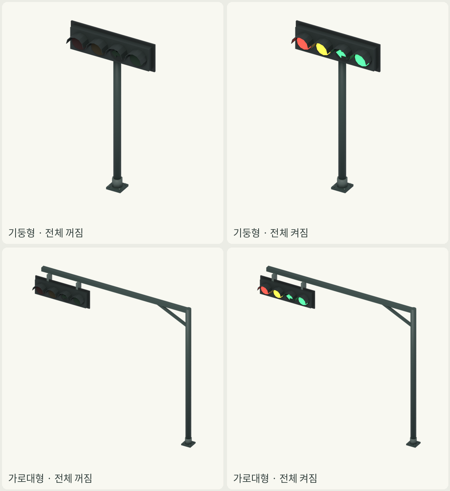
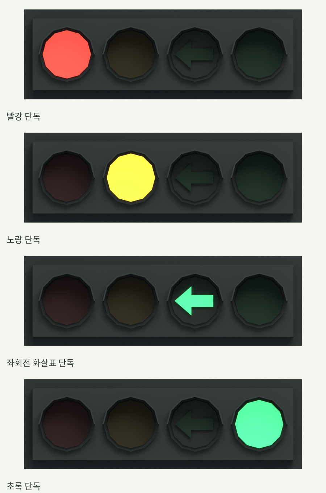

# 차량 신호등2종 · 한국식 가로4구

브랜치 `assets/traffic-signals-20261113`, 기준 main `71ee703`.
두 편집 원본은 **모든 램프가 꺼진 상태**로 저장했다. GLB/게임 배치/신호 주기 제어는 만들지 않았다.



| ID | 기둥 높이 | 전체 높이 | 가로대 길이 | 머리 아래끝/노면 간격 | 삼각형 |
|---|---:|---:|---:|---:|---:|
| traffic-signal-post-01 | 4.50m | 4.92m | 0 | 4.08m | 764 |
| traffic-signal-arm-01 | 6.50m | 6.50m | 7.00m | 5.28m | 788 |

전체 높이와 기둥 높이는 구분했다. 가로대형 머리 아래끝은4.5m 기준과3.53m 차량 높이보다 높다.
기둥형은2·3차선, 가로대형은4차선 이상용 시안이며 실제 도로 폭별 배치나 수용량을 구현하지 않았다.
가로대는 원점 기둥에서−X로7m 뻗고 머리는 끝 쪽에1개만 달았다. 두 머리의 형상/재질/지름은 동일하다.
렌즈 지름.45m는 가상 기본 지름.30m 대비1.5배다. 한 머리 크기는2.60×.535×.84m다.

## 정확한 오브젝트/재질 계약

원본 구조: `SignalRoot`(기둥 바닥 중심0,0,0) → `SignalHead` → 램프4개와 고정 하우징/차양.
Blender에서 정면−Y/왼쪽+X/위+Z, glTF/Godot에서 정면+Z/왼쪽+X/위+Y 규약이다.
**정면 관찰자가−Y에서+Y를 바라보는 화면**에서 빨강→노랑→좌회전→초록이다.
따라서 이 화면에서 램프 중심은 X음수→양수 순서이며 좌회전 화살표 끝은−X를 향한다.
이는 자산 자체의+X 왼쪽 프레임 표기와 관찰자가 마주 보는 화면의 좌우를 구별한 것이다.

| 노드 이름 | 켜짐 재질 | 꺼짐 재질 |
|---|---|---|
| lamp_red | mat_lamp_red_on | mat_lamp_red_off |
| lamp_yellow | mat_lamp_yellow_on | mat_lamp_yellow_off |
| lamp_left_arrow | mat_lamp_left_arrow_on | mat_lamp_left_arrow_off |
| lamp_green | mat_lamp_green_on | mat_lamp_green_off |

- 네 노드는 서로 다른 메시/데이터다. 각 램프의 재질 슬롯0 하나를 교체하면 그 등만 바뀐다.
- ON은 해당 색+Emission Strength2.0, OFF는 아주 어두운 같은 색/Emission0/roughness.88이다.
- 좌회전 `lamp_left_arrow` 자체는 돌출된 화살표 메시다. 뒤의 `arrow_lens_backing`은 고정된 어두운 원형 렌즈다.
  따라서 화살표만 켜지고 원형 배경 전체가 초록색으로 발광하지 않는다. OFF에도 화살표 모양이 희미하게 남는다.
- ON/OFF8재질 모두 fake user를 지정해 미사용 ON 재질도 all-off blend 저장 후 사라지지 않게 했다.
- 뒤에서 보는 수평 광선은 고정 단색 HeadBackboard에 먼저 닿는다. 뒷면용 램프는 없다.

Blender에서 한 등만 켜는 예:
```python
bpy.data.objects['lamp_red'].data.materials[0] = bpy.data.materials['mat_lamp_red_on']
```
끄려면 같은 슬롯에 `mat_lamp_red_off`를 넣는다. 이 재질 교환은 지오메트리를 변경하지 않는다.

## 한 등씩 실제 점등 렌더


기존 머리만 정면으로 촬영한 별도 부품 확인 장면이다. 네 프레임 모두 동일한 카메라/빛이며 재질만 바꿨다.
활성 램프의 실제 픽셀 색과 나머지3개 중심의 어두운 픽셀도 검사했다. 이미지 색을 사후에 칠하지 않았다.
전체4개 동시 켜짐은 색/재질 검토용이며 실제 교통 신호 단계나 안전한 점등 조합을 정한 것이 아니다.

## 원본과 미리보기

- [기둥형 원본·spec·꺼짐/켜짐 PNG](../../assets/street-furniture/traffic-signal-post-01/)
- [가로대형 원본·spec·꺼짐/켜짐 PNG](../../assets/street-furniture/traffic-signal-arm-01/)

각 폴더의 signal.blend는 OFF, preview-off.png / preview-on.png는 같은3/4각도1100×1100 RGBA/투명이다.

## 게임 쪽 후속 변환에 필요한 점

- GLB를 만들 때 네 `lamp_*` 메시를 다른 하우징/램프와 합치지 않고 노드명/재질 슬롯을 유지해야 한다.
- **Blender fake user는 blend 보존 기능이다.** 기본 GLB 내보내기는 미사용 ON 재질을 생략할 수 있다.
  spec.json의 `material_definitions`에8개 재질의 선형 RGBA/발광색/발광 세기/거칠기를 저장했으므로,
  후속 변환기가 ON 재질을 명시적으로 포함하거나 게임에서 이 정의로 만들어 사용할 수 있다.
- Godot에서는 해당 MeshInstance3D의 surface0 override material만 교체하는 방식으로 연결할 수 있다.
  실제 Godot 이름 보존/GLB 임포트·머티리얼 에너지 대응·배치·교차로 단계표·AI·성능은 이번에 검증하지 않았다.

## 이번 검증/재현/출처

- [원본66검사·32개 조합](validation.json): 두 원본 재개방,8재질 보존/발광·OFF,4노드 독립,
  모든16가지 조합×2종, 정확한 순서/화살표 방향, 원점/메터/가로대−X/여유 높이/삼각형,
  고정 후판 차폐, 머리 형상·재질 해시 동일, 검증 중 원본 무기록까지 통과했다.
- [PNG/실제 단독 점등 픽셀 검사](image-validation.json): 원본4PNG 크기/RGBA/투명/잘림/해시,
  단독4프레임의 활성 색과 다른 세 등 어두움 확인.
- Blender4.3.2 CPU Cycles48샘플(단독32샘플), 기존 차량의 단색 재질 helper를 사용했다.
- 실제 재사용: tools/build_vehicle_fleet.py의 material, .agents/skills/vehicle/blender/common.py의 reset_scene/empty.
  도형은 이 작업의 원래 저폴리 메시/상자/원기둥/차양/화살표 코드다. 차량 스킬의 전체 실사/리깅 파이프라인을 실행한 것은 아니다.
- 기존 상류 https://github.com/duolahypercho/zstack 고정판74f7786e9931b9ced858a0e2df880f23e4c2430e, MIT.
  [기존 MIT 라이선스 복사](../../assets/street-furniture/LICENSE-vehicle-MIT.txt). 기존 helper/업스트림 파일은 수정하지 않았다.
- 외부 모델/텍스처/폰트/생성형 이미지/API/에이전트 사용 없음. 보고서 배치만 기존 Pillow/Noto 시스템 도구로 했다.
- 현재 게임 코드·카탈로그·도로/교차로 규칙·가격·요금은 변경하지 않았다. 보행자 신호등/머리2개짜리 가로대/GLB 없음.

```sh
blender -b --factory-startup -t 4 -P tools/build_traffic_signals.py
blender -b --factory-startup -t 2 -P tools/verify_traffic_signals.py
blender -b --factory-startup -t 4 -P tools/render_signal_states.py
python tools/build_traffic_signal_review.py
```

## 가격·제어 용량·자체 수요 제안 · 미승인/미적용

| 애셋 | 설치비 제안 | 유지비 제안 | 시작 자금50,000doth 대비 |
|---|---:|---:|---:|
| 기둥형1개 | 400doth | 1doth/게임월 | .8% |
| 가로대형1개 | 900doth | 2doth/게임월 | 1.8% |

같은4구 머리에 기둥·가로대 구조/기초 공사 차이를 둔 초안이다. 일반2차로8m당80doth 제안과 비교해5배/11.25배다.
4방향에1개씩 설치하는 단순 비교는1,600/3,600doth(시작 자금3.2/7.2%)이며 실제 설치 개수/교차로 정책은 별도다.
도로 건설비에 신호등을 포함하는 정책이면 별도 설치비를 중복 부과하지 않는다. 이번에는 어떤 금액도 차감하지 않는다.

제어 용량은 **머리1개·독립 램프4채널**, 접근 방향1개에 대한 표시용이다. 도로 차선 수/대기열/차량 처리량을 수치로 보장하거나
여러 신호등의 용량을 합산해 교차로 통행량을 늘리지 않는다. 주기/차량AI/제어기·네트워크는 미구현이다.
두 종류 모두 램프당8W/4등 최대.032kW, 점등 듀티 평균.012kW/머리를 제안한다. 교차로 제어기 공통.004kW는 별도1회만 계상한다.
정격32W는4개 모두 켜지는 확인용 최대이며 실제 평균 점등 수/요금은 단계표 결정 뒤 산정해야 한다.
운영 용수/하수/연료/상시 배출물은0 제안이다. 교체 시 금속·렌즈·전자 부품 잔재를 회수해야 하며 교체 주기/질량은 미정이다.
전력/제어기·노출/가림·렌즈 각도/고장이 표시의 병목이며, 저장/생산량을 갖는 시설이 아니다. 모든 수요/금액은 제안만 문서화했다.
